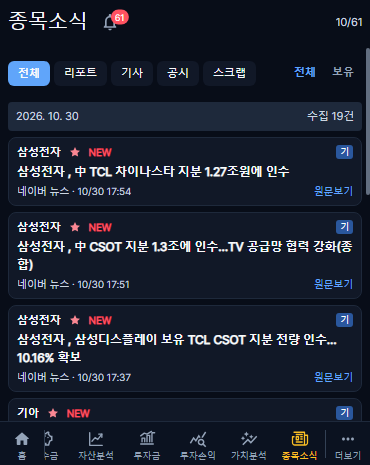
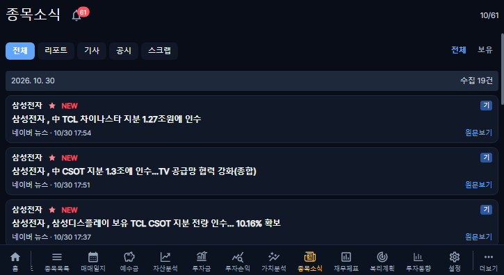
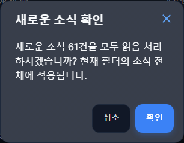

# 종목소식 NEW·읽음 상태

운영 반영 완료: v1.2.54. [PR #378](https://github.com/byungho-cho/roxstock/pull/378), 운영 이미지 커밋 `92d1e2bd1d41c95f146b21aa87db483a449c6b91`. 웹 적용 시각은 2026-10-31 21:11:56 KST이며, 운영 동작 검증은 21:12:41 KST에 완료했다.

- 미확인 소식의 종목명 옆에 빨간색 NEW를 표시한다. 요약을 성공적으로 열거나 유효한 원문보기를 누르면 확인 처리한다. 목록 조회·스크랩 조작만으로는 확인 처리하지 않는다.
- 제목은 공통 글꼴의 20px·일반 굵기(400)를 사용한다. 제목 옆 알림 아이콘 배지는 서버가 계산한 현재 필터 전체의 미확인 건수를 표시한다.
- `모두 확인` 텍스트 버튼은 제거했다. 알림 아이콘을 누르면 건수와 함께 모두 읽음 처리 여부를 묻고, 확인한 경우에만 실행한다. 취소·바깥 클릭·닫기는 저장하지 않는다.
- 일괄 확인은 현재 계좌·유형·전체/보유 필터의 전체 조회 스냅샷에 적용한다. 더보기 전 자료도 포함하지만 스냅샷 이후 수집된 소식은 포함하지 않는다.
- 확인 이력이 없는 기존 소식도 NEW로 표시된다. 모두 확인으로 한 번에 정리할 수 있다.
- `StockNewsRead`는 사용자·소식의 복합 기본키와 최초 확인 시각만 저장한다. 같은 소식은 계좌를 바꿔도 같은 사용자의 읽음 상태를 재사용하며, 다른 사용자와 공유하지 않는다.
- GET은 읽음 상태를 변경하지 않는다. 개인별 PUT 경로는 기존 인증·CSRF·계좌 소유권 검사를 사용한다. 중복 확인은 멱등 처리하고 최초 확인 시각을 유지한다.
- 일괄 확인은 서버에서 500개씩 처리하며 하나의 트랜잭션으로 반영한다. 새 소식·수집 스케줄·원문·요약·스크랩은 수정하지 않는다.
- 저장 성공 후에만 NEW를 제거한다. 실패하면 상태와 재시도를 제공하며 재시도는 실패한 동일 작업의 범위를 유지한다. 단건 확인 실패를 일괄 확인으로 확대하지 않는다.
- 사용자 데이터 백업에도 `stock_news_reads`를 포함한다.

## 적용

`20261031060000_stock_news_reads`는 새 테이블만 추가하는 마이그레이션이다. 로컬 개발·독립 테스트 DB와 운영에 적용했다. 운영 DB 압축 백업(82,634,768바이트)의 gzip 무결성과 SHA-256을 확인한 뒤 적용했다. 공유 Prisma 모델 변경으로 백엔드·수집기·웹 이미지를 함께 갱신했다. APK는 변경하지 않았다.

복구 시 이전 백엔드·수집기 이미지 `b5765790c2486541bfda7d05397712374dd886fa`, 웹 이미지 `92693b81e44fa7bb7a6659b82eb2ec123ac08727`와 보존한 설정·릴리즈 메타데이터를 사용한다. 코드 복구를 위해 읽음 테이블을 삭제하거나 운영 DB 전체를 과거 백업으로 덮어쓸 필요는 없다. 새로 기록된 사용자 읽음 상태도 보존한다.

## 검증

- 프런트 TypeScript·빌드, 백엔드 TypeScript 통과.
- 독립 로컬 MySQL: 미확인 기본값, GET 무변경, 단건 저장, 재조회 유지, 사용자 분리, 타인 계좌 차단, 반복 저장 시각 보존, 일괄 필터·스냅샷·중복 반영 방지, 원문 무변경 통과.
- 백업 범위 테스트 3개 통과.
- 커버 370×465·태블릿 725×396: 신규 기능 8개와 기존 소식 회귀 12개 통과. 읽음 전후, 재진입·새로고침, 더보기 이전 자료까지 일괄 확인, 필터 범위, 저장 중 잠금, 실패·재시도, 원문 클릭을 확인했다.
- 운영 연결·데이터 변경 없이 로컬 서버를 실행했으며 한투 실시간 연결은 로컬에서 비활성화했다.

- CI에도 독립 MariaDB 읽음 검증과 커버·태블릿 NEW·배지·확인/취소 검증을 추가했다.

## 운영 결과

- PR 검사: 29개 성공·6개 정상 건너뜀·실패 0. 소식 브라우저 20개(새 기능 8개·기존 회귀 12개)와 실제 MariaDB 검증을 포함한다.
- [Production Deploy #41197235435](https://github.com/byungho-cho/roxstock/actions/runs/41197235435): 성공.
- 운영 API·브라우저 31개 검증 통과. 실제 소식의 전체 미확인 건수, 단건·필터별 일괄 확인, 멱등성, 확인 취소, 사용자·계좌 분리, 인증·CSRF 차단, 더보기 전 자료까지 반영, 새로고침·새 브라우저 세션 유지, 원문 표본·스크랩 보존을 확인했다.
- 제목 20px·일반 굵기(400), 숫자 배지와 확인 팝업을 커버 370×465·태블릿 725×396에서 확인했다. 가로 넘침·브라우저 오류는 없었다.
- 5개 서비스 모두 해당 운영 이미지·정상 상태. 수집 확인 시작점 `20261028`과 기존 과거 보완 작업의 상태별 건수가 배포 전과 같으며 과거 보완 수집을 재개하지 않았다.
- 검증에는 임시 개인 계정과 기존 운영 원문을 사용했다. 신규 가상 기사·실제 매매·예수금 기록은 만들지 않았다. 임시 계정과 복구 파일 잔여 0개를 확인했다.
- 기존 소식을 삭제하는 기능이 아니다. 확인하면 해당 사용자의 NEW·미확인 배지가 해제되며, 조회 스냅샷 이후의 신규 소식은 다시 NEW로 표시된다.

아래 화면의 건수는 검증용 개인 계정에서 실제 운영 원문을 조회한 결과이며 서비스에 고정한 값이 아니다.

