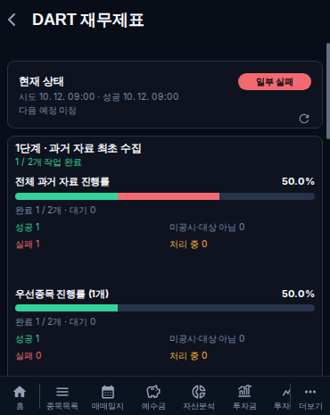
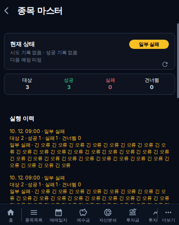
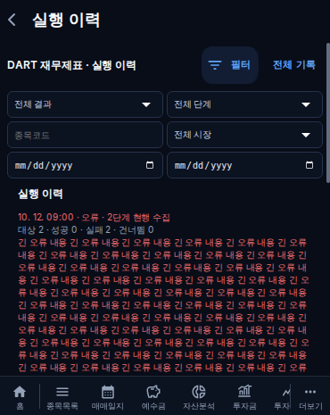
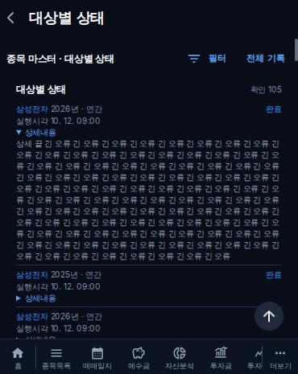
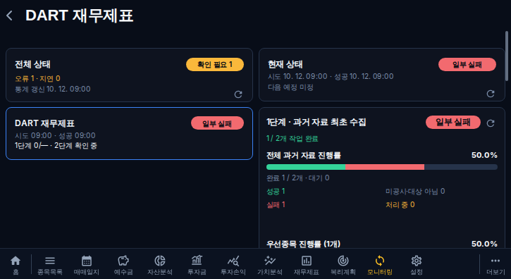
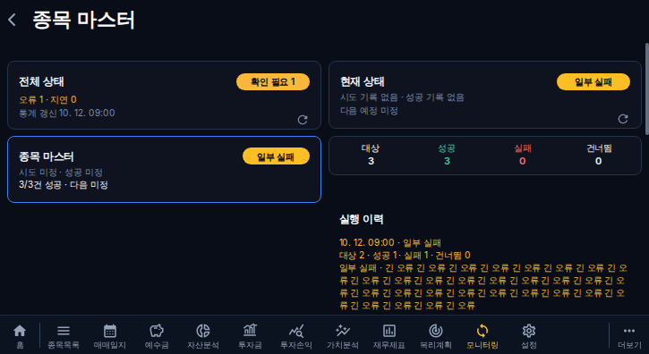
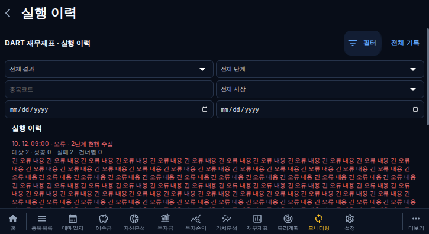
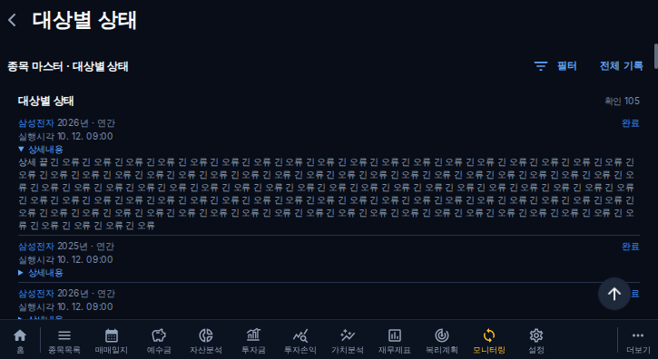

# 21차 모니터링 검증·배포

개선 PR #198, 문서 커밋 배포 누락 보호 규칙 보완 PR #202. 최신 main의 #194/#196 수집기 보정을 유지했다. #137은 병합하지 않았고 #197 기획 문서 초안과 중복되는 앱 구현은 없었다. 이전2.5배 확대는 취소했다.

## API 검증

실제 격리 MariaDB에 테스트 기록만 생성해 실행/대상 각각0·49·50·51·105건을 조회했다. 최초50, 추가50, 마지막5 반환과 hasNext 종료를 확인했다. 동일 시각은 BigInt ID 내림차순으로 구분하며 새 기록 추가 뒤 기존 ID 상한 스트림에서 중복/누락이 없었다. 서로 다른 연도/보고기간의 같은 종목을 보존했다. API는 대상의 run.jobType으로 전체 작업을 독립 조회하고 최근 실행50개 ID에 의존하지 않는다. 필터/기능/목록 커서 혼용은400이다.

- [MariaDB 실제 API 조회 기록](../development/evidence/phase21-api-ci-20261012.json)
- [화면별 요청 URL·limit·cursor·높이 측정](../development/evidence/phase21-ui-ci-20261012.json)
- 운영 읽기 검증: 배포 이후 runs/items limit3·50와 다음 커서를 조회한다. 실제 운영 원본 변경/대량 재수집 없음. 운영 증거에는 건수·정렬/중복 여부만 기록하고 내용/계좌 정보는 복사하지 않는다.

## 화면 검증

커버370×465/태블릿725×396 Chromium production build에서 신규 및 기존 재무제표 관련 검사38개 통과. 요약0·1·3건 및 실행/대상 각0·49·50·51·105건을 검증했다. 제목/컨트롤은 먼저 표시되고 초기 조회 중 실제 빈 상태로 오인할 문구를 표시하지 않는다. 더보기 중 목록 유지/동기 잠금, 실패 후 재시도, 필터 변경 첫50건, 늦은 응답 분리, 뒤로가기/캐시 복귀를 확인했다. 모든 영역은 main의 스크롤만 사용한다.

색상: 대상 textPrimary 흰색, 성공 positive 녹색, 실패 error 적색은 항목명과 수치가 같다. 건너뜀 기존 수치색 유지. 실행 PARTIAL 상태/요약/오류 문구는 warning 노란색이다. 직접 이미지도 확인했다.

기준 main 화면과 변경 화면에 동일한 긴 오류 fixture를 적용한 실제 콘텐츠 높이는 아래와 같다. 가변 높이로 바뀌었으므로 표시 내용·행 수에 따라 달라진다.

| 뷰포트 | 이전 실행/대상 | 이후 긴 오류 실행/접힌 대상 |
|---|---:|---:|
| 370×465 | 240 / 300px | 666 / 104px |
| 725×396 | 240 / 300px | 666 / 104px |

요약0건은 빈 안내 한 줄만, 3건은 오류 줄바꿈/3개 행 높이만 남는다. 실제 측정은 JSON을 따른다.

PNG의 이전 화면은 DART 요약 fixture, 이후 요약은 종목 마스터3건/PARTIAL fixture다. 이후 실행 상세는 DART의 동일한 긴 오류 fixture, 대상 상세는105건/동일 종목의 서로 다른 연도 fixture다. 높이 JSON의 전후 측정은 같은 DART 요약 fixture끼리 비교했다.

### 커버

이전: 

이후 요약: 

실행 상세·필터: 

대상 상세·긴 오류: 

### 태블릿

이전: 

이후 요약: 

실행 상세·필터: 

대상 상세·긴 오류: 

## 검사 원인 분류

최초 신규 UI 검사의 개발 StrictMode 취소 요청 계수, 본문/하단 메뉴의 동명 더보기 선택, 결과 저장 변수명이 검사 코드 문제였다. production preview·본문 선택·변수 타입 검사로 해결했다. 기존 재시도 회귀는 조회별 실패 시점이 달라, 통계 실패가 확정되기 전에 다른 영역을 클릭하던 검사 순서 문제였다. 통계 영역의 실패/재시도를 명시했다. 제품의 필터 변경 시 첫50건 초기화는 별도로 보완했다. 로컬 Chromium 설치 환경 문제는 반복하지 않고 GitHub Chromium에서 검증했다.

## 배포·미확인

PR Gate와 관련 회귀/TypeScript/빌드, 백엔드·프런트 이미지 빌드/푸시·운영 적용 결과, main/배포 SHA는 최종 개발 문서 및 PR에 기록한다.

실제 Android/WebView 기기 확인은 수행하지 못했다. 시각+ID 커서와 ID 상한은 삽입 중 페이지 경계 변동을 줄이지만, 조회 중 이미 저장된 실행의 상태가 RUNNING에서 완료로 바뀌는 것까지 과거 시점에 고정하는 DB 스냅샷은 아니다. 새로운 최신 내역은 요약의60초 갱신/새 목록 조회에 반영한다.

최초 배포38189052305의 성공 상태는 서버 적용을 뜻하지 않았다. 운영 API404와 서버 로그의 Superseded deployment skipped를 대조해 문서 PR200 때문에 적용이 생략됐음을 확인했다. PR202의 문서 전용 후손 허용 보완과31개 실제 Git/자동화 회귀, 필수 타입/빌드/API PR Gate가 통과했다. 최신 배포f4bd59a의 실제 서버 적용 및 API 검증을 완료 보고에 구분한다.

### 운영 API 결과

[GET8회 실제 근거](../development/evidence/phase21-api-live-20261012.json): DART 요약 실행/대상 각각3건, 상세 실행/대상 각각50→50건·중복0·정렬 통과. 종목 마스터는22건·hasNext=false. 백엔드 f4bd59a 및 모든 기존 수집기 컨테이너 healthy 확인. 프런트/백엔드 실제f4bd59a 적용과 Production Deploy38189809433 success를 확인했다. [프런트 실제 번들 근거](../development/evidence/phase21-frontend-live-20261012.json).

최종 버전: f4bd59abdb8a43d5d9239a06b8c8be2b35872962. [운영 배포](https://github.com/byungho-cho/roxstock/actions/runs/38189809433)에서 백엔드·프런트 빌드/푸시/서버 적용 모두 success이며, 실제 컨테이너 태그와 healthy, API 응답 및 프런트 번들까지 확인했다. [최종 개발 기록](../development/phase21-monitoring-20261012.md).
