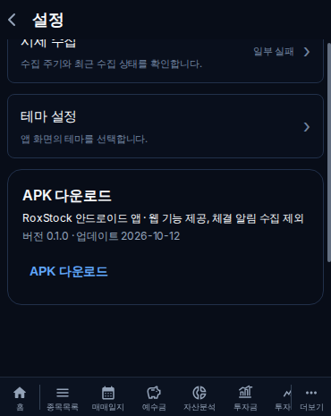
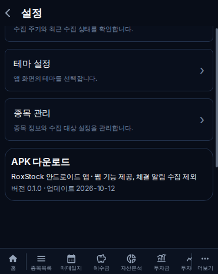
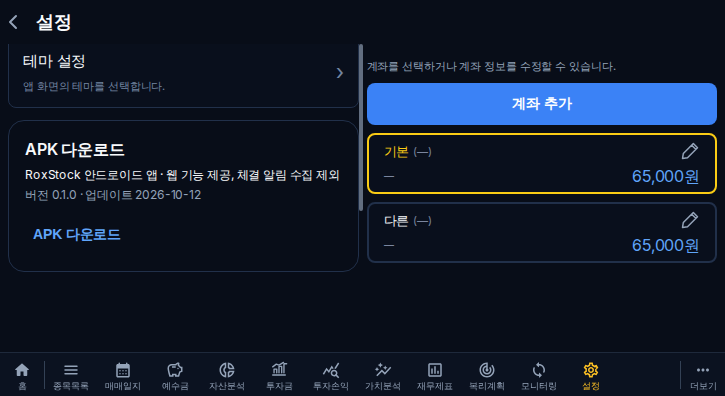
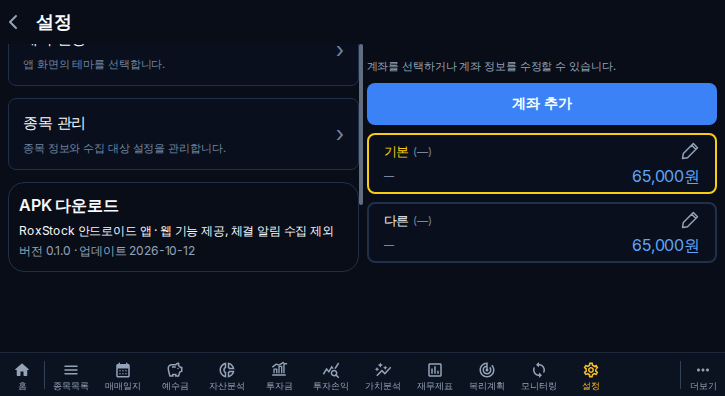
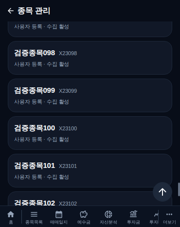
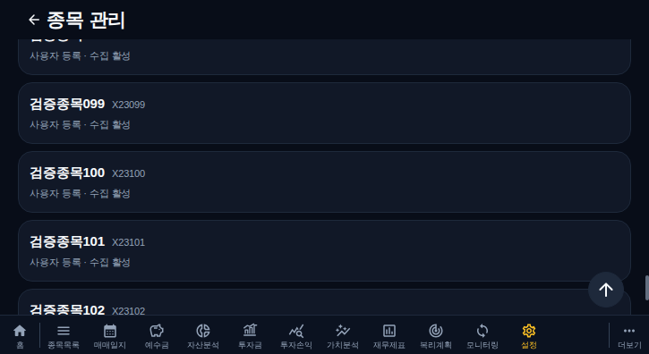
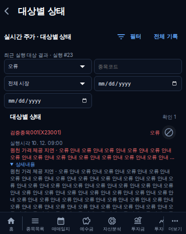
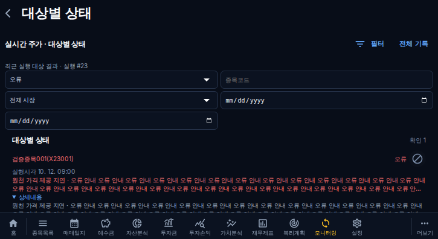
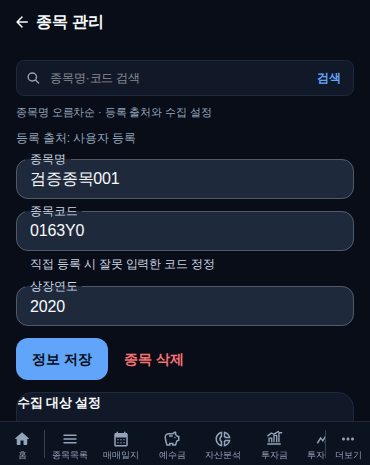
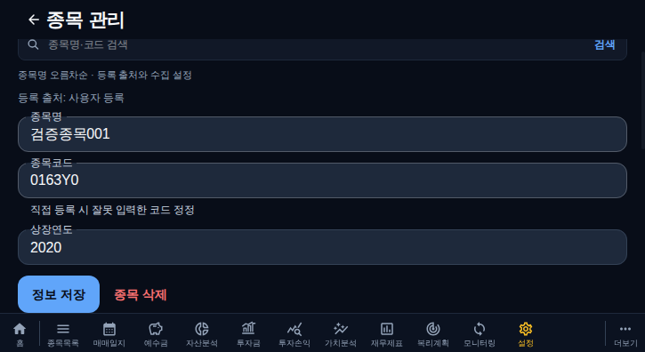

# 23차 검증 기록

## 검증 범위

- 서버: 실제 격리 MariaDB에서 마스터 50→50→5 조회, 출처별 코드 권한, 정규화·유일성 동시 저장, 삭제 참조 보호, 과거 자료 보존, 성공/실패 실행 조건과 집계 일치, 전체/기능별 외부 호출 차단, 코드/설정 버전 변경 중 지연 응답 및 저장·브로커 전달 차단.
- 화면: 커버 370×465·태블릿 725×396에서 집계 이동·실시간 종목명(코드), 실패 요약/상세, 제외 취소·저장 실패·재활성화·Z99 해제 차단, 마스터 50개씩·단일 스크롤, 검색 포커스/한글 조합/Enter, 코드 정정 경고·권한·삭제 불가 이유, APK 카드 다운로드·키보드 링크·전후 실제 높이.
- 기존 21차·부분 로딩·기본 수집/금융/거래 관련 회귀를 유지한다. 전체 화면 QA/전체 장시간 다중 뷰포트 검사는 추가하지 않는다.

## 근거

`backend/tests/phase23-migration.integration.ts`는 기존 main의 스키마에 원본 코드·가격·실제 0 이익을 넣고, 검증된 gzip 백업 → 새 마이그레이션 → 원본 비교 → 기존 스키마 복원 → 재적용을 실제 MariaDB에서 검사한다.

`backend/tests/security-management.integration.ts`는 localhost CI DB만 허용한다. 운영 DB 비밀번호를 출력하거나 변경하지 않는다. 외부 공급자는 통제된 응답을 사용해 호출 수와 지연 결과를 확인하며 운영 대량 재수집을 하지 않는다.

`frontend/tests/targets/phase23-management.spec.ts`와 `playwright.phase23.config.ts`는 운영과 동일한 프로덕션 빌드를 사용한다. 이전 main을 별도 빌드해 APK 전후 높이와 화면을 비교한다. 화면/API fixture 증거와 운영 읽기 검증을 구분한다. 테스트용 APK 응답은 다운로드 링크 동작 검증용이며 실제 운영 APK 설치 검증을 대신하지 않는다.

검증 완료 수치와 CI/PR/운영 배포 링크는 결과 확정 후 추가한다.

## 미확인

Android 실제 모바일 키보드·WebView·APK 설치는 확인하지 않았다. 브라우저의 Enter·한글 조합 이벤트 검증과 별도로 남긴다. 기존 출처를 입증할 증거가 없는 종목은 코드 수정 권한을 주지 않는다. 해당 종목의 출처 증명·변경은 별도 근거 확인이 필요하다.

## 확정 검사 결과

구현 [PR #205](https://github.com/byungho-cho/roxstock/pull/205), 검증 코드 `6688341273503b939326a4a2bd88a3da039bc823`, main `08664e4482dd45a81a38cf1378cdd3f679830511`(2026-10-12 13:20:47 KST 병합). PR Gate [38202728727](https://github.com/byungho-cho/roxstock/actions/runs/38202728727) 및 관련 23개 검사 성공, 변경 범위 외 6개 자동 제외, 실패 없음.

- 백엔드 단위·회귀 206개, 프런트/백엔드 TypeScript·빌드 통과.
- 실제 MariaDB API 마스터 조회 50→50→5. 같은 정규화 코드 동시 저장은 200/409, 중복 저장 1건으로 제한. DART/미확인 출처 정정 차단, 보유·관심 참조 삭제 차단, 일반 정보 수정 허용.
- 전체/7개 기능별 제외: 외부 호출 0, 지연 응답 1개에서 저장 0·브로커 전달 0. 원본/실패 이력 보존, Z99 정정 및 수동 가격 유지, 계좌 집계 지속. 새 코드의 일부 자산·배당·주식수 입력 후 이전 코드의 순이익·EPS·BPS·자기주식은 혼입되지 않음.
- 기존 스키마의 ID `23`, 코드 `000023`, 가격 `1234`, 전일가 `1200`, 실제 순이익 `0`, 자본 `1000000`은 gzip 백업→신규 마이그레이션→구 스키마 복원→재적용 후 모두 동일. 마이그레이션 재적용은 멱등, 기존 출처는 UNKNOWN.
- 화면 14개 검사 통과. 370×465·725×396에서 성공/실패 클릭의 실행/상태 조건, 긴 오류 전체 접근, 제외 취소/저장 실패/재활성화/Z99, 목록 50개씩 및 중복 클릭 보호·본문 단일 스크롤, 검색 진입 무포커스·조합 중 Enter 방지·Enter 검색 후 blur, 코드 경고·출처별 권한·삭제 불가 안내·APK 전체 링크/키보드 다운로드 확인.

| 화면 | 변경 전 APK 높이 | 변경 후 APK 높이 | 감소 |
| --- | ---: | ---: | ---: |
| 커버 370×465 | 151.8125px | 89.8125px | 62px (40.8%) |
| 태블릿 725×396 | 151.8125px | 89.8125px | 62px (40.8%) |

증거: [DB/CI 결과](../development/evidence/phase23-ci-20261012.json), [높이 측정](../development/evidence/phase23-ui-metrics-20261012.json). 운영 데이터가 아닌 격리 DB/화면 fixture 검사임을 구분한다. 최초 검사 실패는 추가 타입 선택 필드/테스트 중복 속성·더보기 선택자 충돌이었으며 원인을 수정했다. 최종 화면 대조에서 닫히는 확인창의 문구와 하단 설정 활성 경로도 교정한 뒤 재검증했다.

### 변경 전후 화면

## 운영 배포·읽기 확인

[Production Deploy 38203404392](https://github.com/byungho-cho/roxstock/actions/runs/38203404392)는 2026-10-12 13:29:22 KST 성공했다. 백엔드/프런트 Docker Hub 빌드·푸시와 실제 서버 배포 모두 수행됐고 건너뛴 배포가 아니다. 이미지 태그는 `sha-08664e4482dd45a81a38cf1378cdd3f679830511`이다. 백엔드·일반/실시간/DART 수집기 및 프런트 컨테이너 healthy를 배포 로그에서 확인했다. 운영 DB 비밀번호를 출력하거나 변경하지 않았다.

배포 전 서버 내부 DB 백업을 gzip 검사 및 SHA256과 함께 저장한 뒤 신규 마이그레이션을 정상 적용했다. 이전 정상 이미지도 복귀용으로 기록했다.

- 운영 종목 관리 API 첫 50개/다음 50개, 중복 0개 확인.
- 같은 실행·상태 기준의 실시간 성공 37건/실패 1건, 계좌 스냅샷 성공 3건/실패 2건, DART 성공 3,377건·실패 97건의 첫 페이지(50건 한도)가 집계와 일치. DART 실패는 50→47, 중복 0개, 마지막 더보기 없음. 당시 실패들은 기존 이력이며 오류 원인 분석/원본 상태 소급 변경은 본 작업에서 하지 않았다.
- 종목 마스터의 과거 실행은 개별 대상 기록이 없어 —와 미기록 사유를 유지하며 원본 실행 집계는 보존한다. 신규 실행부터 실제 대상별 결과를 기록한다.
- 운영 `index-B5I-tAJ5.js` 및 `SecurityManagementPage-obMbqood.js`가 200으로 제공되고 관리 API·코드 경고·출처 권한·제외 설정 코드가 포함됨을 확인.
- 기존 APK `0.1.2-webonly-test`/`roxstock-web-only-0.1.2.apk` 메타데이터·HEAD/GET 200, 61,360바이트, 공개 메타데이터 SHA256과 실제 다운로드 SHA256 일치. APK 파일·버전·URL은 변경하지 않음.

근거: [운영 API](../development/evidence/phase23-api-live-20261012.json), [운영 프런트/APK](../development/evidence/phase23-frontend-live-20261012.json), [배포 로그 근거](../development/evidence/phase23-deploy-20261012.json). 공개 사이트 `/health/db`는 프런트 라우팅으로 노출되지 않아 DB 상태는 정상 운영 API 조회와 서버 내부 healthy 검사로 확인했다.

남은 확인: 실제 Android 키보드·WebView·설치, 과거 등록 출처의 근거 확인. UNKNOWN 종목의 코드 수정은 차단된 상태이며 기존 값을 사용자 등록으로 임의 분류하지 않았다. 운영 원본에 테스트 거래·종목·제외 설정을 추가하거나 대량 수집을 실행하지 않았다. main 직접 push와 #137 병합은 하지 않았다.
