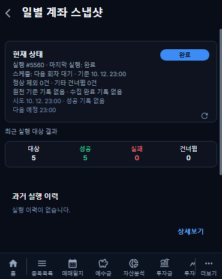
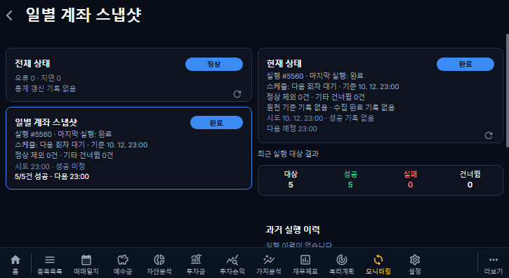
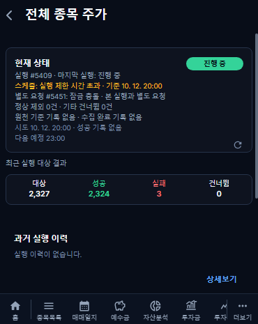
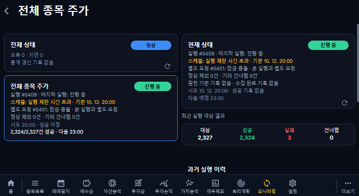

# 25차 QA

- 프론트/백엔드 TypeScript·빌드 통과.
- 백엔드 전체217검사 통과. 자정/다음 회차/10분 경계/장시간 경계/복수 예정 시각, 성공·정상 제외·전체 제외·unknown·잠금 충돌·stale·실패, 종료 요청을 검사했다.
- 격리 로컬 MariaDB roxstock_phase25_test의 실제 DB/API 2검사 통과. 살아 있는 lease와 다른 소유자의 갱신·해제 차단, 만료 소유자만 복구, 대상 원본·복구 전 상태 보존, 요약 본 실행/중복 요청 ID, 기존 PARTIAL의 검증된 정상 제외 판정, success/excluded 분리, 상세·대상 원문을 확인했다. 운영 DB 쓰기 없음.
- Chromium 커버370×465 / 태블릿725×396: 신규4 + 기존 모니터링32 =36검사 통과. 마지막 실행과 스케줄 표시 분리, 지연 본 실행 뒤의 중복 요청, 가로 넘침 없음, 상세 이동, 3건/50건 독립 조회·추가 조회·필터·오류 재시도·스크롤·뒤로가기 유지 확인.
- 초기 실제 API 검사에서 응답 필드 누락, 초기 화면 검사에서 현재 카드 안내 누락을 발견해 제품 코드를 고쳤다. 단순 재시도로 통과 처리하지 않았다. 기존 경로 검사에는 추가 집계 조회 mock을 반영했다.

## 모의 화면

캡처는 API 모의 데이터이며 운영 적용 증거가 아니다. 실제 운영 API·DB·Docker journal 조회 근거는 [개발 기록](../development/phase25-monitoring-status-20261013.md)에 따로 기록했다. CI에는 전용 UI 및 MariaDB 검사 workflow를 추가했다.

미검증: 실기기 터치/WebView, 수정 후 운영 반영·5409 복구·정상 스케줄 장기 관측, 소유권 근거가 없는 과거 실행, 삭제된 컨테이너의 종료 스택, 9/27 HTTP400·403 원문 세부 원인. 이번 PR은 병합·배포하지 않는다.
