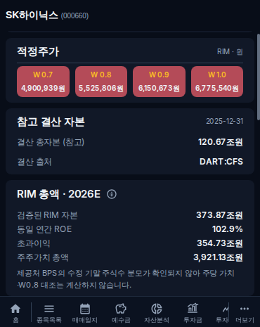
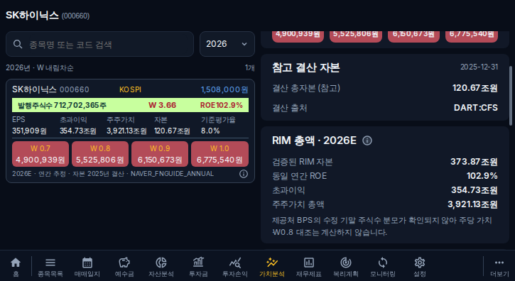

# 26차 검증 · 2026-10-13

초안 PR [#210](https://github.com/byungho-cho/roxstock/pull/210), 기준 main `3d2bd4f`, 제품 코드 검증 커밋 `26b956c73ed5ae69194d895cfb1820ee01094529`, 회귀 기대값 보완 `38c25f10f4e3d68a31f1731f53860c510887ef0b`. 운영 배포/DB 수정/수집 실행/병합 없음.

## 검증 구분

- 로컬: 프런트·백엔드 TypeScript 및 빌드 통과, 백엔드 단위/도메인/라우트 회귀 220건 통과. Decimal 대금액·소수·0·음수, 출처·기간·귀속 불일치 시 계산 제한 검증 포함.
- 실제 MariaDB: CI 격리 DB에서 계좌2개·종목2개의 원본 매수 Lot/매도/배당을 생성해 scope API와 반복 캐시 응답을 검증. 운영 DB 원본은 사용/수정하지 않음. 별도 주식수 integration에서 실제 SK 저장 API의 수치와 동일한 2026E 원천 숫자로 DB→DAL→API 총액을 검증.
- 화면: Chromium API route fixture, 운영에서 읽은 SK 응답을 테스트 입력으로 사용. 기준 main과 변경 코드를 같은 조건에서 비교. fixture는 테스트 전용이며 제품 조회에 사용하지 않음.
- 실제 Android 키보드·WebView·실기기는 미검증. 제공처 원문 재조회·운영 DB 직접 dump도 미실시; source→저장 경로는 API provenance/collectedAt와 도메인/DB/API integration으로 대조.

## 항목별 결과

|항목|변경 및 검증 범위|
|---|---|
|1 포커스|연결 예수금 수정의 초기 로딩 완료 뒤 세후예수금900원 포커스. 메모 입력 후 실제 visibility refetch에도 포커스/작성값 유지. 일반 입출금/배당 등록에는 세후예수금 필드가 없어 기존 금액/세전 배당 포커스를 유지; 금액 의미·원본 저장 정책을 임의 변경하지 않음.|
|2 보유 요약|주식수와 평가수익률을 64px 가운데 열·가운데 정렬, 매매수익률 열과 좌표 일치. 0 매입금액은 —. 소수 주식수 유지.|
|3 색상|평가금액·매도총액 양수/음수/0 확인. 매수총액1000원·매도총액300원이어도 연결 Lot 매매손익100원이면 매도총액 적색.|
|4 연도 손익|같은 계좌/종목1=120원, 종목4=−30원, 계좌2/종목4=505원으로 분리. 연도 상세 URL과 cache scope 동일. 실제 DB에서도 서로 다른 계좌·종목, 연결 배당, 반복 응답 검증.|
|5 홈|보유→최근 매수→목표가 도래. 커버 정상0건 높이290→98px(33.8%), 태블릿290→290px. 제목·0건·빈 안내·갱신시각 유지. 초기 조회/503 실패는 축소하지 않음.|
|6 진입/여백|홈·종목목록 보유 진입 summary 우선. 기존 거래 탭 방문 뒤 새 보유 진입에도 요약. 요약 카드 상하8px.|
|7 설명|제목 옆 정보 아이콘 클릭으로 전체 출처/CFS/OFS/저장 데이터 설명·백만원 단위 확인. tooltip viewport 안, Esc/바깥 클릭 닫힘.|
|8 가치분석|중간 공시를 표시 주식수 조회에 포함하되 연간 계산 근거와 분리. 같은 NAVER 2026E 지배주주자본/ROE 검증 후 총액 정상 표시. 수정 BPS 분모 미검증은 null/구체적 설명. 2025 참고 자본과2026E RIM 분리.|
|9 W 카드|네 W 라벨 전체 노란색, 동일 너비, 구분선 다음4px. 기존 가격 계산 유지.|

## 가치분석 근거와 제한

[실제 저장 API 근거](../development/evidence/phase26-sk-source-20261013.json), [개발/계산 설명](../development/phase26-improvements-20261013.md).

2026E CFS 지배주주자본 **373,868,000,000,000원**, 동일 제공처 연간 ROE **102.88%**. 초과이익 **354,725,958,400,000원**, 주주가치 총액 **3,921,127,584,000,000원**. 기존 W0.8 **5,525,805.84768원** 유지. 표시 발행주식수 **712,702,365주**는 2026-06-30 반기 보통주 공시이며 제공처 BPS 수정 분모로 사용하지 않는다. 주당 총액/기존 가격 차이는 분모 근거 부족으로 null. 이를 해결할 운영 데이터 보정은 이번 작업에서 수행하지 않았다.

## CI 및 화면 근거

- [최종 제품 코드의 화면 16/16 통과](https://github.com/byungho-cho/roxstock/actions/runs/38334147471), 커버370×465/태블릿725×396. 기준 main 전후 실제 browser capture, 최종 artifact11783983045.
- [Backend Check 통과](https://github.com/byungho-cho/roxstock/actions/runs/38333798419): 실제 MariaDB scope 및220개 회귀, 백엔드 타입/빌드.
- [실제 DB RIM/API 증명](https://github.com/byungho-cho/roxstock/actions/runs/38333798451), api job115089246001 성공. `PHASE26_RIM_SQL_API_PROOF`의 실제 DB→API 총액과 기존 가격/null 비교 결과를 [검증 JSON](../development/evidence/phase26-validation-20261013.json)에 기록.
- [최종 회귀 기대값 커밋의 화면16/16 재확인](https://github.com/byungho-cho/roxstock/actions/runs/38334354037), [백엔드 검사 재확인](https://github.com/byungho-cho/roxstock/actions/runs/38334354131) 성공. 추가 repo 자동 회귀는 결과 확인 후 기록. 이 문서의 통과 표기는 지정한 커밋·run에 대한 결과이며 운영 적용 상태를 뜻하지 않는다.

## 전후 화면

다음은 테스트용 API 응답을 사용하는 Chromium 캡처다. 운영 배포 화면이 아니다. 자세한 변경 파일은 PR의 Files changed에서 확인한다.

|화면|커버 이전|커버 이후|태블릿 이전|태블릿 이후|
|---|---|---|---|---|
|보유 요약|[이전](assets/phase26/cover-stock-before.png)|[이후](assets/phase26/cover-stock-after.png)|[이전](assets/phase26/tablet-stock-before.png)|[이후](assets/phase26/tablet-stock-after.png)|
|홈 목표가 카드|[이전](assets/phase26/cover-home-before.png)|[이후](assets/phase26/cover-home-after.png)|[이전](assets/phase26/tablet-home-before.png)|[이후](assets/phase26/tablet-home-after.png)|
|재무제표 설명|[이전](assets/phase26/cover-financial-before.png)|[클릭 설명](assets/phase26/cover-financial-tooltip-after.png)|[이전](assets/phase26/tablet-financial-before.png)|[클릭 설명](assets/phase26/tablet-financial-tooltip-after.png)|
|가치분석|[이전](assets/phase26/cover-value-before.png)|[이후](assets/phase26/cover-value-after.png)|[이전](assets/phase26/tablet-value-before.png)|[이후](assets/phase26/tablet-value-after.png)|

세후 포커스: [커버](assets/phase26/cover-cash-focus-after.png) / [태블릿](assets/phase26/tablet-cash-focus-after.png).

## 검사 실패 처리

 이전 실패는 Node JSON fixture 로딩, visibility event 전달, 실패 요청 retry 제어, 태블릿 list fixture 누락, 변경된 기본 탭/포커스/종목 scope와 기존 기대값 충돌로 분류해 수정했다. 실패 원인 없이 반복 실행하지 않았다.

추가 보완: 이전 phase6 검사는 계좌 전체 응답과 종목 scope 응답의 총 요청을1회로 가정했다. 두 범위는 분리되어야 하므로 scope별 각1회, 불필요 Lot/trade/capital 요청0 및 기존 상세 동작 검증을 유지한다. 새 검사는 전체 요청 수만 느슨하게 허용하지 않는다.

후속 기대값 수정: 범위별 aggregate 응답이 준비되면 과거 거래 원본 재조회도0회다. 기존 검사 마지막의 raw trade1회 기대값을0회로 고쳤다. 최종 phase26 workflow에 해당 회귀를 커버/태블릿2건으로 함께 실행하도록 추가했다. 기존 broad phase6의 마지막 실패는 제품 오류가 아닌 이 기대값의 오류이며 기존 기능 검사29건 및 phase7의9건은 통과했다.
