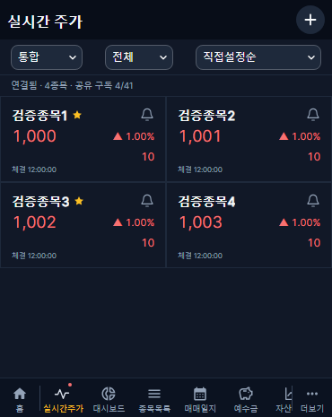
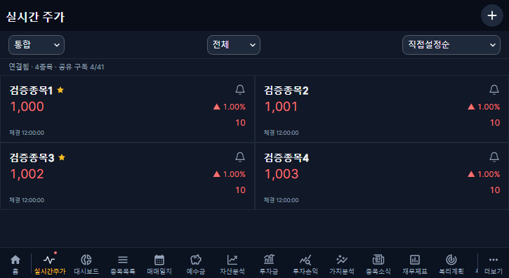
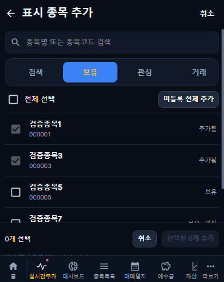
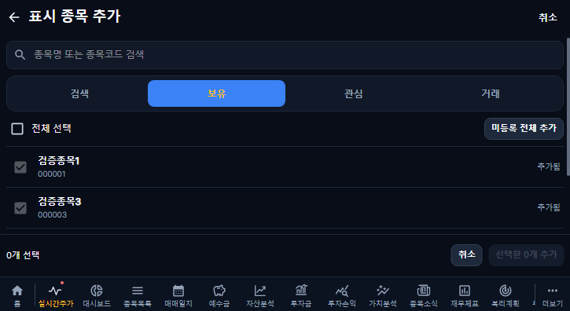
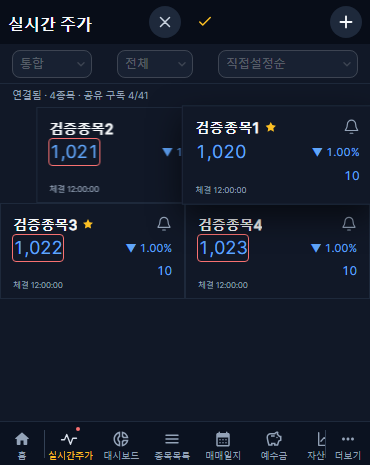
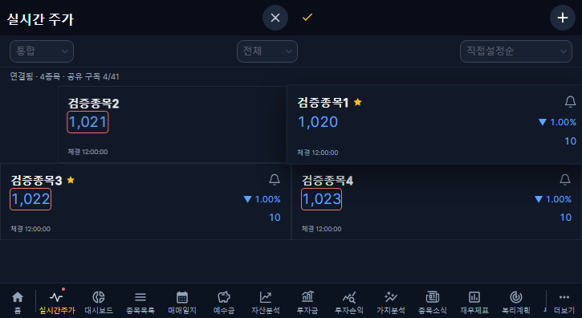

# 실시간 주가 표시·조작·캐시 개선 · 2026-10-30

## 기준과 범위

main bb34047f825bda41c8f7e8dd64751b9d3ea0fb08(v1.2.49)와 열린 PR을 확인한 별도 codex/live-quotes-polish-20261030 브랜치다. 재무 보완 PR #340 및 운영/문서 PR 범위를 포함하지 않는다. 사용자 후속 명세를 우선하며 앱 버전은 v1.2.50이다.

- 현재가 22→17.6px(20% 축소), 굵기 600→500. 같은 줄 우측 등락률, 다음 줄 우측 등락액. 긴 값은 겹침 없이 말줄임과 전체 값 접근성 이름/제목으로 확인한다.
- 카드의 X 제거. 별·종과 헤더 순서 취소(X)/저장(✓) 유지. 다른 삭제 UI는 추가하지 않는다.
- 500ms 롱프레스 후 카드가 커지고 그림자가 생기는 고정 오버레이로 손가락을 따라간다. 원래 카드 노드는 자리 표시로 유지한다. 주변 카드 FLIP 이동, 180ms 안착, 자동 스크롤·터치 스크롤 구분·클릭 억제·reduced-motion 대응을 적용한다.
- 드롭 무저장·편집 즉시 헤더 버튼·취소 복원·일괄 저장·409 충돌/저장 실패 유지와 기존 필터 내 순서 정책을 보존한다.
- 시장/필터/6정렬은 기존 MUI Select/테마를 공유하며 컨트롤 아래에 펼친다. usePopupHistory로 뒤로가기·바깥 클릭·선택 닫기를 지원한다. 화면 경계/높이를 제한한다.
- 추가 화면은 PageHeader, StockSearchFrame, SegmentedTabs, ActionButton과 기존 체크박스 테마를 재사용한다. 검색/초기화 아이콘·고정 하단 추가/취소 영역·목록 하단 여유를 제공하며 선택과 중복 방지/저장 규칙은 유지한다.

## 전체 리프레시 원인과 수정

주가 목록에는 이미 주기 refetch가 없었다. 실제 원인은 AuthGate가 5분마다 /auth/me를 확인할 때 checking만으로 전체 화면 오버레이를 표시하던 동작이다. 실시간 주가 관련 화면에서 기존 인증 사용자의 배경 재확인은 화면을 덮지 않으며 인증 요청 자체는 계속한다. 초기 신원 확인·명시적 신원 전환/blocked·확정 세션 만료의 차단과 캐시 정리는 보존한다. 다른 화면/로그인 폼의 기존 복귀 확인 보호도 그대로 유지한다.

목록 갱신 오류가 나도 기존 데이터가 있으면 카드를 유지하고 상태와 재시도만 안내한다. 카드 key는 종목 ID, 시세/시장 변경으로 재생성하지 않는다. 드래그/포인터 조작 중에는 표시 순서를 고정한다.

## 마지막 시세와 강조

- 기존 React Query 메모리에 사용자·시장별 최신 시세만 저장한다. 종목당 한 값이며 원래 observedAt을 보존한다. 시장별 최대 500종목, 화면 사용 중에는 요청 없는 관찰자로 유지하고 화면 이탈 후 비활성 캐시는 30분이다. 디스크·시세 이력·DB·추가 REST 요청을 만들지 않는다.
- 재진입/재연결은 마지막 시세를 표시하고 통신/휴장/한도 상태도 구분한다. 처음 값이 없으면 수신 대기, 다른 시장 값으로 채우지 않는다. 로그아웃/사용자 전환은 기존 client.clear와 사용자별 키로 분리한다.
- 새 LIVE 가격을 같은 종목/시장 직전 표시 가격과 비교한다. 현재가 영역만 1초 빨강/파랑 테두리 후 220ms로 사라진다. 첫 값·보관 복원·같은 값·시장 전환 차이는 새 강조를 만들지 않는다. 연속 변경은 방향/기한을 갱신한다.
- 숫자 색상은 전일 대비, 테두리는 직전 값 대비다. 보관 가격과 대기/오류 상태를 실제 실시간 성공으로 바꾸지 않는다.

## 검증

- 커버 370×465, 태블릿 725×396: 실시간 UI 28검사 통과. 가격 크기/굵기·한 줄 배치·X 제거·팝업 위치/뒤로가기·터치와 롱프레스·자리 표시·드래그 중 시세·안착/무저장·자동 스크롤·취소/저장/실패·시장 캐시/재진입·상하 연속 강조·숫자/테두리의 독립 색상·계정 전환 캐시 제거를 확인했다.
- 5분 시각을 진행하고 실제 /auth/me 요청을 지연시킨 검사에서 원래 카드 DOM·100px 스크롤·편집 상태가 유지됐다. 단순히 인증 검사를 멈춘 결과가 아니다.
- 31분 화면 유지 후 재진입 캐시 복원을 확인했다. 읽기 전용 관찰자는 skipToken으로 요청을 실행하지 않으며 화면 갱신도 구독하지 않는다.
- 드롭 안착 종료와 포인터 고정 해제 사이 잠깐 원래 순서가 나타나는 경계는 함께 해제하도록 수정했다.
- 같은 손짓으로 원래 칸에 돌아오는 조작은 이동 중인 이웃의 시각 좌표 대신 논리 그리드 칸으로 판정해 안정화했다.
- 기존 인증·세션·대시보드 회귀 46검사 통과. 로그인 폼의 신원 확인 가림·신원 변경 차단·로그아웃/재시도/동시 갱신 보호를 확인했다.
- TypeScript 검사 통과. 필수 CI·실제 이미지·운영 결과는 배포 후 아래에 갱신한다.

## 전후 화면

이전 캡처는 v1.2.49 운영의 임시 표시 목록이다. 이후 캡처는 격리된 UI 검증 값이며 운영 DB에 저장하지 않았다. 실제 개인 자산·키·원본 로그는 게시하지 않는다.

## 운영 보호와 복구

한투 수신·구독/공유·서버 메모리·인증 API·표시 목록 저장 API·기존 60초 수집 경로는 변경하지 않는다. DB 마이그레이션·계좌/매매/예수금/재무 데이터 보정·과거 수집 재개가 없다. 웹 변경만이며 APK는 유지한다.

배포 전 정상 이미지/실행 상태와 증분 시작점·과거 대기열을 읽기 전용 보존하고 배포 후 대조한다. 복구는 정상 v1.2.49 frontend 이미지 sha-42ee73911a3bdb06b6e5bae03e5ae917f938af89와 런타임 버전 메타데이터로 웹만 선별 복원한다. DB 복원/기존 수집기 재시작은 필요 없다. 클라이언트 시세 캐시는 휘발성이라 새로고침/로그아웃으로 제거할 수 있고 개인 투자 데이터와 분리된다.

## 배포 결과

아직 운영에 반영하지 않은 개발 검증 결과다. 필수 검사 통과 후 main 병합·운영 배포·실제 수신/수분 연속 유지·최종 적용 시각/커밋을 확인해 갱신한다.
