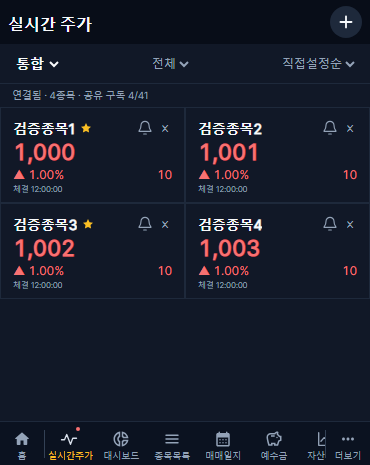
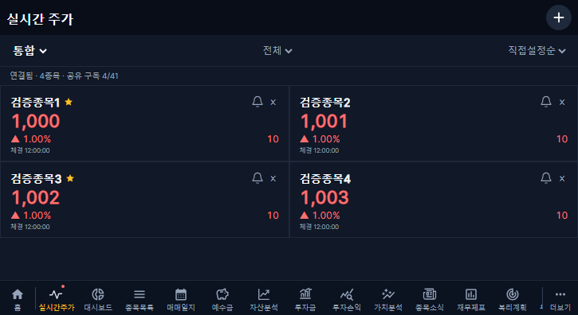
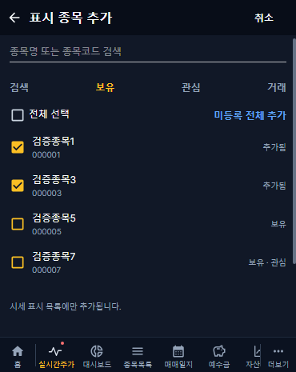
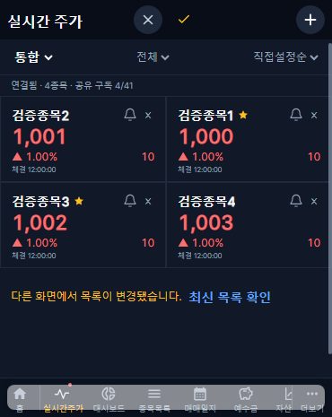

# 실시간 주가 · 대시보드 · 백업 날짜 개선 (2026-10-30)

## 변경 범위

- Figma C/T3400 V1.0 및 추가·순서 편집 화면 직접 대조. 공통 고정 헤더·+ 버튼·하단 메뉴 재사용. 홈 다음 실시간주가, 다음 대시보드 순서이며 시세 파형과 은은한 붉은 점은 Figma 원본 SVG다. 커버 370×465·태블릿 725×396 모두 2열이다.
- 한투 웹소켓은 서버 한 연결을 공유한다. 동일 시장/종목은 중복 구독하지 않고 공식 앱키당 1세션·전체 41구독 제한을 적용한다. 제한을 초과하는 표시 카드는 숨기지 않고 한도 초과를 안내한다. 접수 순으로 구독 슬롯을 유지하고, 시장 전환 시 해제 후 새 구독을 등록한다. 임의 회전으로 모든 종목이 실시간인 것처럼 보이지 않는다.
- 서버 최신 값은 시장·종목별 메모리 한 값이며 인증된 SSE로 1초 단위 전달한다. 초기·연결 복구 시만 시장별 UN/NX/J REST 시세로 보완하고 같은 종목 요청은 30초 안에 중복하지 않는다. REST를 1초마다 호출하지 않는다.
- 연결·재연결·구독 한도·시장 미지원/구독 거절·장 운영시간 외·원천 확인된 거래정지·최근 체결 없음·지연을 구분한다. 조회/저장 가격과 실제 체결 시각을 구별한다. 무체결만으로 거래정지나 시장 미지원을 추정하지 않는다.
- 표시 종목과 직접 순서는 기존 auth_users.settings.liveQuotes의 IDs·revision만 저장한다. 별도 테이블/마이그레이션 없음. 같은 사용자의 장치에서 공유하며 계좌 보유·관심·거래 판정은 기존 소유권 필터와 calculateHoldings 경로를 사용한다. 실제 거래·관심 등록·예수금은 변경하지 않는다. 기존 사용자 설정과 충돌하는 동시 저장은 409로 막는다.
- 정렬: 직접 순서, 종목명 오름차순, 현재가·등락률·평가 보유금액·미실현 평가손익 내림차순. 보유금액/손익은 보유 종목 우선, 나머지는 직접 순서. 동률도 직접 순서로 고정한다. 수신된 가격과 기존 잔여 매수원가를 이용하며 실현손익을 섞지 않는다.
- 직접순 500ms 롱프레스·드래그, 이동 위치 강조·가장자리 스크롤. 드롭 후 DB 저장하지 않으며 첫 변경 즉시 헤더 X/✓를 보여준다. 취소·원상 복귀 시 숨기고, 실패 시 편집 유지. 필터 밖 자리 보존. 동시 목록 변경은 최신 추가·제거를 유지한 명시적 병합 후 재저장할 수 있다. 미저장 이탈은 확인창, 계좌 변경은 안내하며 편집을 유지한다. 이를 위해 공통 라우터를 동등한 데이터 라우터로 전환했으며 기존 useTransitions=false 동작을 유지한다.
- 대시보드 도넛/목록: 6종목 이하는 모두, 초과는 상위 5+기타. 기타는 생략한 전체 평가금·투자금·비중을 합산한다. 도넛과 같은 집합·색상, 아래 16px 여백, 현재 계좌를 유지하는 실시간주가 링크.
- 백업 목록 날짜: Asia/Seoul·24시간 YY/MM/DD HH:mm. 자동/수동·전체/사용자 공통이며 저장 시각·정렬은 유지한다.

## 보호와 복구

기존 60초 NaverPriceProvider 수집, 홈 시세 전달·평가·스냅샷 저장 경로를 보존한다. 새 화면 수신과 기존 평가용 주기 저장의 목적을 구분하며 기존 경로를 삭제/전환하지 않았다. 과거 재무 보완 큐·일정·개인 데이터·수기 값·감사/오류 이력은 변경하지 않는다.

서버 CollectorLock의 별도 kis-live-quotes 키로 다중 프로세스 소유를 제한한다. 금융 수집 잠금과 독립적이다. 소유 갱신은 20초, 만료 90초이며 시세를 DB에 저장하는 작업이 아니다. 연결이 닫히기 전 새 연결을 열거나 소유 잠금을 먼저 풀지 않는다. SSE 종료/로그아웃/세션 만료 시 구독 수요를 해제하며 세션은 15초마다 재검증한다. 백엔드는 기존 수집기의 비공개 토큰 캐시 볼륨을 공유한다.

배포 전 전체 DB 압축 백업 80,261,561bytes 완료. 별도 서버 비공개 위치 복제·SHA-256 일치·gzip CRC 검사 완료. 운영 5개 컨테이너 설정 사본도 0600으로 보존했다. 백업 원본·키·토큰·접속키는 Git/보고서에 게시하지 않는다. 이 작업에서 전체 DB 복원은 수행하지 않았다.

코드 복구는 배포 기록의 이전 backend/frontend 이미지와 compose-template으로 선별 복구한다. DB 스키마가 변하지 않으므로 사용자 DB 전체를 덮어쓰지 않는다. 기존 설정에 추가된 liveQuotes는 이전 앱에서 무시할 수 있어 그대로 보존한다. 필요한 경우 사용자별 하위 설정만 변경 후 사본과 대조하여 선별 복구한다. 긴급 중지 시 KIS_LIVE_ENABLED=false로 백엔드 재시작하거나 이전 이미지를 복구한다. 다른 수집기는 중지하지 않는다.

## 검증

- 새 서비스 실제 운영 키 시험: 12:36:20~12:36:44 KST, 삼성전자·SK하이닉스, 통합→KRX→NXT 순차. 각 시장 8초 표본에서 두 종목 모두 실제 KIS 체결 확인. 승인 1회, 최초 보완 REST 6회. 시험 후 소켓 0·별도 잠금 0, 기존 서비스 시작 시각 모두 불변. NXT/통합/KRX 값이 구분되는 실제 응답 확인. 실전 키·원문 응답·토큰은 공개하지 않는다.
- 백엔드 전체 190통과·기존 실DB 인증 통합검사 1개 로컬 미실행. 백업 파일 교체 검사는 제한된 파일 환경에서 EPERM이 발생했으나 정상 접근 환경에서 전체 재실행 통과했다.
- 추가 순수 검사: 6정렬·필터 순서·47필드/시장·다중 레코드·날짜·등락 부호·기타 보존합·백업 한국시간 경계.
- API 검사: 익명 차단, 두 사용자 조회 분리, 위조 userId 무시, 동일 revision 동시 저장 중 1개만 성공, 기존 설정 보존.
- 소켓 모의 검사: 동일 종목 중복 제거·한 세션·시장 해제/등록·원천 값 유지·재연결·종료.
- 커버/태블릿 화면 10검사 통과: 2열·1초 숫자 반영·시장/필터·일괄 추가·드롭 무저장·취소·저장 실패 유지·명시적 저장 1회·새로고침 유지·이탈 확인·터치 스크롤/롱프레스 구분. 아래 캡처는 허구의 격리 테스트 데이터다.
- 기존 가치지표 차트·스크롤/뒤로가기·설정 지연 로딩·손익 여백 등 26개 회귀 검사와 기존 거래 편집 2개 검사가 통과했다. 새 메뉴의 버튼 수·SVG 규격 기대값을 갱신했으며 계산 검증을 제거하지 않았다.
- TypeScript 프런트/백엔드 검사·빌드 통과. Vite 기존 대형 청크 경고는 오류가 아니다.

## 화면 캡처

## 공식 근거와 남은 검증

[한투 공식 유량 공지](https://apiportal.koreainvestment.com/community/10000000-0000-0011-0000-000000000001/post/d0d1a83f-6f8d-4437-9700-6d26702fd989): 계좌/앱키당 1세션, 전체 TR 합산 41구독, 접속키 초당 1회. [실시간 필드·TR](https://github.com/koreainvestment/open-trading-api/blob/main/examples_user/domestic_stock/domestic_stock_functions_ws.py), [REST 시장 코드](https://github.com/koreainvestment/open-trading-api/tree/main/examples_llm/domestic_stock/inquire_price).

실제 전화기에서의 장시간 터치·네트워크 전환·24시간 접속키 만료와 41개 실구독 경계는 추가 현장 관찰 대상이다. 한도 계산·재연결은 모의 검사로 확인했으며 실제 41개를 불필요하게 구독하지 않았다. 알림 설정·발송·주문·체결량·분봉 저장·APK 변경은 이번 범위 밖이다.

배포 목표 v1.2.47. 최종 PR/병합 SHA·배포 시각·운영 확인은 배포 완료 후 갱신한다.
