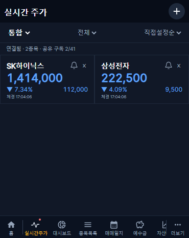
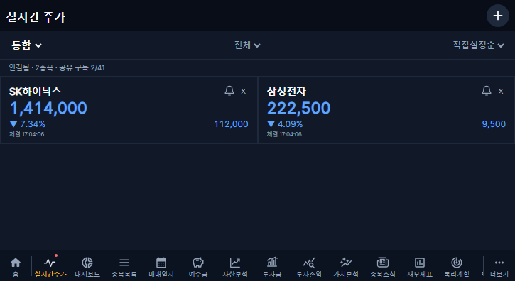

# 실시간 주가 · 대시보드 · 백업 날짜 개선 (2026-10-30)

## 변경 범위

- Figma C/T3400 V1.0 및 추가·순서 편집 화면 직접 대조. 공통 고정 헤더·+ 버튼·하단 메뉴 재사용. 홈 다음 실시간주가, 다음 대시보드 순서이며 시세 파형과 은은한 붉은 점은 Figma 원본 SVG다. 커버 370×465·태블릿 725×396 모두 2열이다.
- 한투 웹소켓은 서버 한 연결을 공유한다. 동일 시장/종목은 중복 구독하지 않고 공식 앱키당 1세션·전체 41구독 제한을 적용한다. 제한을 초과하는 표시 카드는 숨기지 않고 한도 초과를 안내한다. 접수 순으로 구독 슬롯을 유지하고, 시장 전환 시 해제 후 새 구독을 등록한다. 임의 회전으로 모든 종목이 실시간인 것처럼 보이지 않는다.
- 서버 최신 값은 시장·종목별 메모리 한 값이며 인증된 SSE로 1초 단위 전달한다. 초기·연결 복구 시만 시장별 UN/NX/J REST 시세로 보완하고 같은 종목 요청은 30초 안에 중복하지 않는다. REST를 1초마다 호출하지 않는다.
- 연결·재연결·구독 한도·시장 미지원/구독 거절·장 운영시간 외·원천 확인된 거래정지·최근 체결 없음·지연을 구분한다. 조회/저장 가격과 실제 체결 시각을 구별한다. 무체결만으로 거래정지나 시장 미지원을 추정하지 않는다.
- 표시 종목과 직접 순서는 기존 auth_users.settings.liveQuotes의 IDs·revision만 저장한다. 별도 테이블/마이그레이션 없음. 같은 사용자의 장치에서 공유하며 계좌 보유·관심·거래 판정은 기존 소유권 필터와 calculateHoldings 경로를 사용한다. 실제 거래·관심 등록·예수금은 변경하지 않는다. 기존 사용자 설정과 충돌하는 동시 저장은 409로 막는다.
- 정렬: 직접 순서, 종목명 오름차순, 현재가·등락률·평가 보유금액·미실현 평가손익 내림차순. 보유금액/손익은 보유 종목 우선, 나머지는 직접 순서. 동률도 직접 순서로 고정한다. 수신된 가격과 기존 잔여 매수원가를 이용하며 실현손익을 섞지 않는다.
- 직접순 500ms 롱프레스·드래그, 이동 위치 강조·가장자리 스크롤. 드롭 후 DB 저장하지 않으며 첫 변경 즉시 헤더 X/✓를 보여준다. 취소·원상 복귀 시 숨기고, 실패 시 편집 유지. 필터 밖 자리 보존. 동시 목록 변경은 최신 추가·제거를 유지한 명시적 병합 후 재저장할 수 있다. 미저장 이탈은 확인창, 계좌 변경은 안내하며 편집을 유지한다. 이를 위해 공통 라우터를 동등한 데이터 라우터로 전환했으며 기존 useTransitions=false 동작을 유지한다.
- 대시보드 도넛/목록: 6종목 이하는 모두, 초과는 상위 5+기타. 기타는 생략한 전체 평가금·투자금·비중을 합산한다. 도넛과 같은 집합·색상, 아래 16px 여백, 현재 계좌를 유지하는 실시간주가 링크.
- 백업 목록 날짜: Asia/Seoul·24시간 YY/MM/DD HH:mm. 자동/수동·전체/사용자 공통이며 저장 시각·정렬은 유지한다.

## 보호와 복구

기존 60초 NaverPriceProvider 수집, 홈 시세 전달·평가·스냅샷 저장 경로를 보존한다. 새 화면 수신과 기존 평가용 주기 저장의 목적을 구분하며 기존 경로를 삭제/전환하지 않았다. 과거 재무 보완 큐·일정·개인 데이터·수기 값·감사/오류 이력은 변경하지 않는다.

서버 CollectorLock의 별도 kis-live-quotes 키로 다중 프로세스 소유를 제한한다. 금융 수집 잠금과 독립적이다. 소유 갱신은 20초, 만료 90초이며 시세를 DB에 저장하는 작업이 아니다. 연결이 닫히기 전 새 연결을 열거나 소유 잠금을 먼저 풀지 않는다. SSE 종료/로그아웃/세션 만료 시 구독 수요를 해제하며 세션은 15초마다 재검증한다. 백엔드는 기존 수집기의 비공개 토큰 캐시 볼륨을 공유한다.

배포 전 전체 DB 압축 백업 80,261,561bytes 완료. 별도 서버 비공개 위치 복제·SHA-256 일치·gzip CRC 검사 완료. 운영 5개 컨테이너 설정 사본도 0600으로 보존했다. 백업 원본·키·토큰·접속키는 Git/보고서에 게시하지 않는다. 이 작업에서 전체 DB 복원은 수행하지 않았다.

코드 복구는 배포 기록의 이전 backend/frontend 이미지와 compose-template으로 선별 복구한다. DB 스키마가 변하지 않으므로 사용자 DB 전체를 덮어쓰지 않는다. 기존 설정에 추가된 liveQuotes는 이전 앱에서 무시할 수 있어 그대로 보존한다. 필요한 경우 사용자별 하위 설정만 변경 후 사본과 대조하여 선별 복구한다. 긴급 중지 시 KIS_LIVE_ENABLED=false로 백엔드 재시작하거나 이전 이미지를 복구한다. 다른 수집기는 중지하지 않는다.

## 검증

- 새 서비스 실제 운영 키 시험: 12:36:20~12:36:44 KST, 삼성전자·SK하이닉스, 통합→KRX→NXT 순차. 각 시장 8초 표본에서 두 종목 모두 실제 KIS 체결 확인. 승인 1회, 최초 보완 REST 6회. 시험 후 소켓 0·별도 잠금 0, 기존 서비스 시작 시각 모두 불변. NXT/통합/KRX 값이 구분되는 실제 응답 확인. 실전 키·원문 응답·토큰은 공개하지 않는다.
- 백엔드 전체 190통과·기존 실DB 인증 통합검사 1개 로컬 미실행. 백업 파일 교체 검사는 제한된 파일 환경에서 EPERM이 발생했으나 정상 접근 환경에서 전체 재실행 통과했다.
- 추가 순수 검사: 6정렬·필터 순서·47필드/시장·다중 레코드·날짜·등락 부호·기타 보존합·백업 한국시간 경계.
- API 검사: 익명 차단, 두 사용자 조회 분리, 라우트의 인증 사용자 ID 사용, 동일 revision 동시 저장 중 1개만 성공, 기존 설정 보존.
- 재연결 후에는 이전 세션의 최신 값을 유지하되 새 세션의 첫 체결 전에는 실시간으로 표시하지 않는다.
- 소켓 모의 검사: 동일 종목 중복 제거·한 세션·시장 해제/등록·원천 값 유지·재연결·종료.
- 커버/태블릿 화면 12검사 통과: 2열·1초 숫자 반영·시장/필터·일괄 추가·드롭 무저장·취소·저장 실패 유지·명시적 저장 1회·새로고침 유지·이탈 확인·터치 스크롤/롱프레스 구분·오프라인 가격 유지/온라인 복구. 아래 캡처는 허구의 격리 테스트 데이터다.
- 추가로 도넛 0/1/5/6/7/8/14종목·계좌 변경·투자금 토글·기타 합산 등 20개 회귀 검사 통과. 기존 8개 표시 기대값을 새 6개 기준으로 갱신했고 기타 금액은 4종목 전체 합산을 검증한다.
- 기존 가치지표 차트·스크롤/뒤로가기·설정 지연 로딩·손익 여백 등 26개 회귀 검사와 기존 거래 편집 2개 검사가 통과했다. 새 메뉴의 버튼 수·SVG 규격 기대값을 갱신했으며 계산 검증을 제거하지 않았다.
- 프런트 확대 회귀 180개 중 179개 첫 실행 통과. 새 다섯 번째 메뉴 행의 0.125px 잘림은 스크롤 하단 1px 여유로 수정했으며, 원래 모바일·커버·태블릿 설정의 하단 메뉴/관련 화면 21개 재검사 모두 통과했다.
- TypeScript 프런트/백엔드 검사·빌드 통과. Vite 기존 대형 청크 경고는 오류가 아니다.

## 화면 캡처

## 공식 근거와 남은 검증

[한투 공식 유량 공지](https://apiportal.koreainvestment.com/community/10000000-0000-0011-0000-000000000001/post/d0d1a83f-6f8d-4437-9700-6d26702fd989): 계좌/앱키당 1세션, 전체 TR 합산 41구독, 접속키 초당 1회. [실시간 필드·TR](https://github.com/koreainvestment/open-trading-api/blob/main/examples_user/domestic_stock/domestic_stock_functions_ws.py), [REST 시장 코드](https://github.com/koreainvestment/open-trading-api/tree/main/examples_llm/domestic_stock/inquire_price).

[한국투자증권 2026-09-14 시행 안내](https://www.truefriend.com/main/customer/notice/Notice.jsp?cmd=TF04ga000002&num=47532) 및 [거래 안내](https://advisor.koreainvestment.com/main/customer/tradetransfer/_static/TF04da010000.jsp), [NXT 매매제도](https://nextrade.co.kr/menu/transactionSys.do)를 대조했다. KRX의 16:00~20:00 시장 연장을 반영하며 과거 18:00 종료 규칙을 사용하지 않는다. NXT는 08:00~08:50·09:00:30~15:20·15:40~20:00이고, 휴일 판정은 기존 한국시장 달력을 공유한다.

실제 전화기에서의 장시간 터치·네트워크 전환·24시간 접속키 만료와 41개 실구독 경계는 추가 현장 관찰 대상이다. 한도 계산·재연결은 모의 검사로 확인했으며 실제 41개를 불필요하게 구독하지 않았다. 알림 설정·발송·주문·체결량·분봉 저장·APK 변경은 이번 범위 밖이다.

## 병합 및 운영 검증

- [PR #366](https://github.com/byungho-cho/roxstock/pull/366), PR head f3e27ceb033a8b8f2581de4e371edf6ffef67340. 필수 PR 검사 34개 성공·경로상 제외 6개·실패 0개 후 병합했다.
- 병합 커밋 fb638140935df56666d33bd2e48e30185c34ff24, 2026-10-30 13:48:17 KST.
- [최초 운영 배포 41004916468](https://github.com/byungho-cho/roxstock/actions/runs/41004916468)는 backend/수집기는 정상 적용됐으나 frontend Dockerfile의 shared 도메인 복사 목록 누락으로 웹 이미지 빌드가 실패했다. 기존 프런트엔드는 유지됐다. 단순 TypeScript/Vite 빌드로 실제 이미지 파일 구성을 검증하지 못한 누락이었다.
- 14:06:58~14:07:27 KST 운영 API 선행 검증 통과. 통합·KRX·NXT 모두 삼성전자(005930)·SK하이닉스(000660)의 실제 KIS 체결을 확인했다. 각 시장 9개 SSE 데이터 프레임(초기 연결 상태 포함)을 약 1초 간격으로 확인했다. 이는 원시 체결 총건수가 아니다.
- 임시 사용자 두 명으로 목록 최초 저장(SQL NULL 설정 포함)·재조회·독립 목록·순서 저장·제거·복원·기존 다른 설정 보존을 확인했다. 오래된 revision 409, 다른 계좌 404, 위조 userId 필드 400, 비허용 Origin/CSRF 및 일반 사용자의 관리자 백업 접근 403, 익명 401을 확인했다. 기존 /prices/latest 두 종목 200 응답도 유지됐다. 모두 예상된 음성 검사이며 운영 장애가 아니다.
- 검증 계정·계좌·세션은 해당 실행에서 생성한 것만 정리했다. 시험 종료 후 서버 웹소켓 연결 0개를 확인했으며 다른 연결을 강제 종료하지 않았다.
- 41개 할당·42번째 초과 표시·시장 간 한도 공유·중복 수요 제거·해제 후 할당 복구는 실제 서비스 클래스의 오프라인 경계 검사로 통과했다. 네트워크·DB 접근 없이 수행했으며 실제 41종목 구독 시험과 구분한다.
- 수집기 배포 후 증분 시작점 20261028 및 과거 대기열의 상태별 건수가 배포 전과 정확히 같았다. 과거 보완 수집을 재개하거나 이력을 초기화하지 않았다.
- Android 네이티브 변경 없음. 배포 워크플로의 APK 단계는 제외되어 기존 APK를 유지했다.

### 웹 이미지 및 경로 보완

- [PR #367](https://github.com/byungho-cho/roxstock/pull/367): 실제 Docker COPY 목록을 보완하고 실제 이미지 빌드 검사를 추가했다. 병합 6df68cee794b58d0ee043f508d021f4aa7c97ce7, 15:21:21 KST. [배포 41013595493](https://github.com/byungho-cho/roxstock/actions/runs/41013595493) 성공, 웹 v1.2.48 컨테이너 적용 15:47:50 KST. 이 배포에서는 변경 없는 backend/수집기/APK는 재배포하지 않았다.
- 실제 HTTP 검증에서 /live-quotes와 정적 아이콘 폴더 이름 충돌로 nginx가 403을 반환하는 문제를 추가 발견했다. 기존 /assets와 같은 정확 일치 SPA rewrite로 수정했다. 기존 설정 사본 보존 및 별도 컨테이너의 nginx 문법/6개 경로/실제 SVG 검사 후 16:00:18 KST 재시작 없이 복구했다. [PR #368](https://github.com/byungho-cho/roxstock/pull/368)의 정식 이미지에 같은 설정과 HTTP 회귀 검사를 포함한다.
- 브라우저 offline 시 기존 SSE를 닫고 마지막 숫자·카드를 유지하며 재연결 상태를 즉시 표시한다. online이면 새 SSE를 열고 이전 연결에서 늦게 온 응답은 무시한다. 로컬 12개 검사와 필수 Frontend Check의 커버/태블릿 검사에 포함했다.
- 16:13:04~16:13:47 KST 실제 운영: 세 시장의 실제 KIS 수신, 카드 드롭 직후 무저장, 취소 복원, 명시적 저장 1회 및 새로고침 후 순서 유지, 등록 목록 보유 필터/전체 복원/검색 중복 방지 확인. 약 1초 간격 DOM 변경 4회 동안 원래 카드 노드를 유지했다. 브라우저 오류 없음, 검증용 두 계정·계좌·세션 삭제 완료. 이 시점에는 온라인 동작만 검증했고 신규 offline 보완의 운영 검증은 정식 배포 후 별도 기록한다.
- 16:26 KST 실제 동시 API 저장에서 같은 revision의 두 요청 중 200/409 각 한 건을 확인했고 기존 다른 설정을 보존했다. 시세 연결 없이 임시 계정만 사용 후 정리했다.
- 배포된 v1.2.48 웹 번들에 격리 응답을 적용한 백업·투자동향 화면 회귀 18개 통과. 실제 관리자 백업 생성/삭제나 관리자 암호 인증을 실행한 시험과는 구분한다. 백업 날짜 함수는 한국시간 24시간제·날짜/연도 경계를 별도 검증했다.

- 16:42~16:43 KST 두 사용자 SSE 실검증: A는 2종목, B는 그중 1종목만 수신했고 공유 구독은 2개였다. A 로그아웃 후 A 스트림만 세션 재검증으로 종료됐으며 B는 구독 1개로 실제 체결을 계속 수신했다. 사용자별 목록 분리·공유 구독·로그아웃 해제 확인, 임시 사용자/계좌/세션 정리 완료.

### 정식 배포 완료 · v1.2.49

[PR #368](https://github.com/byungho-cho/roxstock/pull/368)은 28개 검사 성공·범위 제외 6개 후 2026-10-30 16:37:06 KST 병합했다. 병합 커밋은 42ee73911a3bdb06b6e5bae03e5ae917f938af89, 버전은 v1.2.49다. [배포 실행 41021183314](https://github.com/byungho-cho/roxstock/actions/runs/41021183314) 성공. 정식 frontend 이미지 sha-42ee73911a3bdb06b6e5bae03e5ae917f938af89 적용 시각은 **2026-10-30 17:01:58 KST**다. 공개 /api/version은 1.2.49, 서비스 5개 모두 healthy다. backend/기존 수집기는 변경이 없어 fb638140 이미지와 기존 시작 시각을 유지했다. 임시 nginx 설정 교체 대신 검증된 정식 이미지로 고정됐다. 아래는 개인 투자자료 없는 임시 표시 목록으로 17:04 KST 확인한 실제 운영 캡처다.

- 17:03:51~17:04:10 KST 정식 v1.2.49 운영 브라우저 검사 통과. 오프라인에서 마지막 가격/카드를 유지하며 재연결 상태를 즉시 표시했고 온라인 복구 후 두 종목 모두 실제 체결 수신을 재개했다. 재연결 전후 원래 카드 DOM이 유지됐다. 4초 표본에서 숫자 변경 4회(간격 997/1000/1009ms)를 확인했다.
- 같은 운영 검사에서 드롭 무저장·취소 복원·저장 한 번·새로고침 유지, SQL NULL 설정 최초 저장, 200/409 동시 저장, 다른 사용자/계좌 차단, Origin/CSRF 차단, 보유 필터/전체 복원·검색 중복 방지·커버/태블릿 2열 모두 통과했다. 임시 계정 2개와 계좌·세션을 정리했다.
- 최종 재대조에서 증분 확인 시작점 **20261028**과 과거 대기열의 모든 상태별 건수가 배포 전과 같았다. 과거 수집/보완을 재개하지 않았다. 시험 종료 후 서버의 한투 웹소켓 연결 0개를 확인했으며 다른 연결을 강제 종료하지 않았다.
- 별도 DB 스키마 변경·마이그레이션 없음. 사용자가 등록한 표시 목록/순서는 기존 사용자 설정의 하위 값으로 저장한다. 기존 개인 거래·예수금·재무/지표·수기 값·감사/오류 이력은 변경하지 않았다. Android APK도 유지했다.
- 완료: 코드/정식 배포/실제 세 시장 수신/1초 화면 반영/재연결/사용자 분리/공유 구독/목록 저장/정렬·터치 및 기존 화면 회귀/도넛 그룹/백업 날짜 검증. 추가 관찰: 실제 전화기의 장시간 접속·OS 네트워크 전환·24시간 접속키 만료, 실제 41개 최대 동시 구독 부하. 후자는 모의 경계 검사와 두 종목 실검증을 구분하며 완료했다고 주장하지 않는다.
