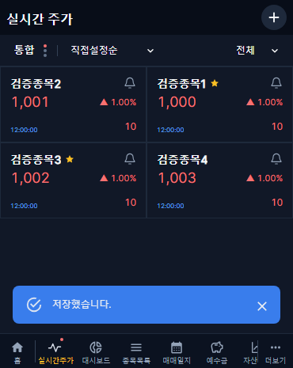
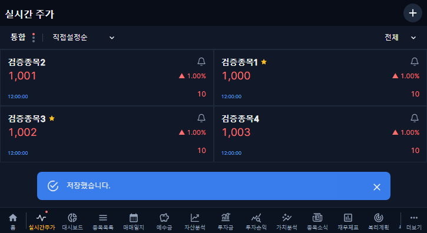
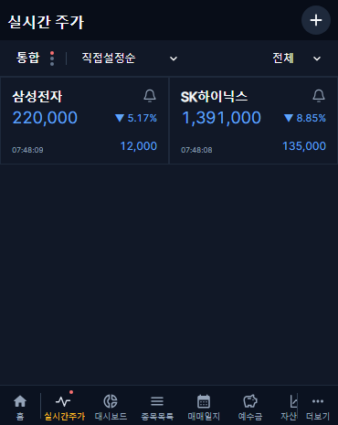
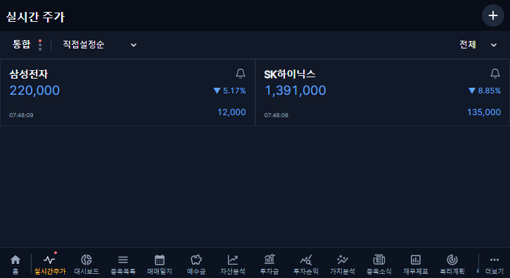

# 저장 시세 최초 표시·카드 정렬·하단 알림 · v1.2.52

## 범위

최신 main bcd3e373 기준, codex/live-quotes-stored-initial-20261031 별도 브랜치. 다른 재무 보완 PR과 개인 작업 파일을 포함하지 않는다.

- 실시간·사용자별 같은 시장 캐시가 없을 때 기존 표시 목록 응답의 KRX 저장값을 먼저 표시한다. 별도 조회나 DB 저장은 추가하지 않는다.
- 통합 화면에서는 KRX 저장 시세임을 출처·접근성 안내에 명시한 참고 표시다. NXT에는 KRX 값을 혼용하지 않는다. 통합으로 재태깅하거나 실시간 캐시에 저장하지 않으며 시장별 정렬 정책을 유지한다.
- 저장 시각을 현재 시각으로 바꾸지 않는다. 저장값은 회색 시각 표시·마지막 시세로 구분하고 연결 오류·구독 제한 상태도 유지한다. 해당 시장 정상 시세가 오면 교체한다.
- 첫 실시간 값·보관값 복원·시장 변경에서 가격 변동 테두리가 잘못 나타나지 않도록 한다. 정상 연속 체결에서만 기존 전일 대비 방향의 강조를 유지한다.
- 시세 시간은 세 번째 줄 왼쪽, 등락액은 오른쪽에 아래 맞춤한다. 카드 높이 96px과 드래그 기준은 유지하며 상하 내부 여백은 각 10px이다.
- 공통 저장/오류 알림은 하단 메뉴와 안전 영역 위에 배치한다. 성공은 primary 파란색, 오류는 기존 오류색을 유지한다. 좌우 여백은 대칭이며 휴대폰 16px, 넓은 화면은 최대 폭 600px로 중앙 정렬한다. 닫기·재시도·자동 숨김·알림 큐는 유지한다.

## 로컬 검증

프런트 타입 검사·빌드 통과. 배포 범위 자동 검사 5건 통과. 커버 370×465·태블릿 725×396에서 실시간 화면·오류 알림 총 58건 통과했다. 성공 알림 좌표 검사는 진입 애니메이션이 끝난 최종 위치를 확인한다.

저장값 최초 표시·잘못된 시각/다른 시장 자료 제외·실시간 교체·시장 전환·재진입·사용자 분리·드래그·저장·취소·종목 관리와 화면 이동을 포함한다. 오류 알림의 하단 배치·대칭 여백·닫기·재시도도 확인했다.

## 배포·운영 확인

- 구현 [PR #374](https://github.com/byungho-cho/roxstock/pull/374), 최종 코드 head 94296d042e79f9b157d75f82de710e371cbdc45f. 필수 CI 28개 성공·6개 비대상 제외·실패 0개.
- main 병합 5a8ef2f478b16b05ac0d7476e440d9dfa6fff1be (2026-10-31 11:46:02 KST).
- [Production Deploy #41161457304](https://github.com/byungho-cho/roxstock/actions/runs/41161457304) 전체 성공. 프런트 통합 회귀·빌드·게시·서버 적용 완료. 백엔드·수집기·APK·투자동향 전용 배포는 비대상으로 제외됐다.
- 웹 적용 **2026-10-31 12:14:23 KST** (웹 컨테이너 시작). 운영 /api/version 200, **1.2.52** 확인.
- 웹만 새 병합 SHA 이미지로 교체됐다. 나머지 4개 서비스의 이미지·기동 시각이 배포 전후 동일하며 전체 5개 서비스 healthy. 증분 확인 시작점과 폐기된 과거 대기열의 상태별 건수도 동일했다.
- 기존 설정·직전 이미지·웹 compose·런타임 버전 메타데이터를 비공개 복구 기준으로 보관했다. DB 마이그레이션·개인 투자 자료 변경·과거 수집 재개는 없다.

### 실제 운영 검증

**2026-10-31 12:15:30 KST** 완료, API·커버/태블릿 화면 **58건 모두 성공**. 별도 임시 사용자 2명과 소유 계좌만 사용했고, 종료 후 해당 임시 사용자·복구 파일 모두 0개를 확인했다.

- 실제 저장 목록 응답의 KRX 저장값을 사용했다. 검증 브라우저에서만 시세 스트림을 차단해 최초 저장값 표시와 원래 시각 보존을 확인한 뒤, 차단을 해제하고 정상 수신 경로를 검사했다. 서버 연결이나 실제 사용자 시세를 끊지 않았다.
- 세 번째 줄의 시각·등락액 아래 맞춤과 카드 아래 10px 여백 확인.
- 실제 표시 목록 저장 후 파란색 알림, 하단 메뉴와 12px 간격, 좌우 대칭 여백을 진입 애니메이션 완료 후 확인.
- 인증·관리자 권한·CSRF·다른 사용자/계좌 차단, 설정 보존, 409 충돌 및 동시 저장 1건만 성공, 50개 제한, 검색 100개/다음 페이지 비중복 확인.
- 등록 체크/해제 무저장·취소 복원·명시적 1회 저장·재진입 유지, 실제 관심 목록 일치, 종목명 이동과 뒤로가기 확인.
- 기존 시세 API 유지, 커버/태블릿 2열·시장 버튼 고정 폭·팝업 16px, 관심 카드 네 적정주가의 실제 서버 값 일치 확인. 브라우저 오류 0.
- 주말이므로 정상 연결·저장/마지막 가격 표시를 신규 체결 수신 검증으로 보고하지 않는다. 새 체결·실제 장중 가격 강조는 다음 장중 확인 대상이며 로컬 이벤트 기반 검사는 통과했다.

운영 화면은 임시 계정·공용 종목만 사용했다. 비공개 인증 정보·개인 자료·운영 원본 로그는 저장소에 포함하지 않는다.

복구는 직전 웹 이미지 sha-b5765790c2486541bfda7d05397712374dd886fa와 보관한 compose/런타임 버전으로 수행한다. DB 복원이나 과거 대기열 초기화는 하지 않는다. 운영 검증에는 전용 임시 계정을 사용하고 종료 후 정리한다. 주말이므로 실제 신규 체결 수신 검증은 다음 장중 확인 대상으로 구분한다.
