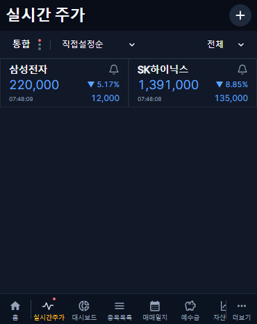
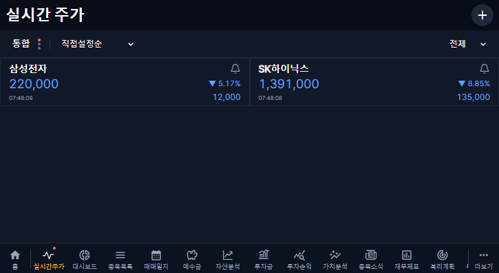

# 실시간 주가 제목·글자 간격 개선 · v1.2.53

## 변경 범위

최신 main cb8e184f 기준의 codex/live-quotes-title-spacing-20261031 브랜치에서 진행했다. 다른 재무 보완 PR과 기존 개인 작업 파일은 포함하지 않는다.

- 제목의 개별 16px 지정을 제거하고 대시보드와 같은 공통 헤더 글꼴·22px·700 굵기를 사용한다.
- 카드의 20/28/18px 고정 행 높이와 현재가 26px 줄 높이를 제거했다. 줄 높이 1과 숫자 글꼴 여백 정리로 보이는 텍스트 사이를 좁힌다.
- 세 행 사이 간격과 상하 내부 여백은 각각 8px이다. 시각과 등락액의 아래 맞춤, 기존 현재가 크기·전일 대비 색상·노란 보유 별·알림 아이콘은 유지한다.
- 숫자의 쉼표·한글이 잘리지 않도록 표시 범위를 보정했다. 텍스트 여백 정리가 지원되지 않는 브라우저도 줄 높이 1로 표시하며, 실제 렌더링된 높이를 드래그 판정에 사용한다.
- 카드 높이가 작아져도 롱프레스·상하 가장자리 자동 스크롤·드롭·취소·명시적 순서 저장을 유지한다. 편집 중 카드의 이동 애니메이션과 논리적 셀 판정은 기존 방식이다.

## 검증과 보호

프런트 타입 검사/빌드와 배포 범위 테스트 5건이 통과했다. 커버 370×465·태블릿 725×396에서 전체 실시간 화면 회귀 54건을 통과했다. 예전 카드 높이의 고정 좌표를 사용하던 빈 영역 클릭 검사는 현재 카드 내부 여백을 사용하도록 수정하고 두 화면에서 재검증했다. 렌더링 캡처로 한글·쉼표·글자 간격도 확인한다. 중간 카드 높이 조정에서 검출된 참조 누락은 최종 수정 후 재검증했다.

## 배포·복구

- 구현 [PR #376](https://github.com/byungho-cho/roxstock/pull/376), 최종 head 699c24b607ecebe6df15c6e6f9671beec55c5c7a. 필수 CI 28개 성공·6개 비대상 제외·실패 0개.
- main 병합 92693b81e44fa7bb7a6659b82eb2ec123ac08727 (2026-10-31 14:08:37 KST).
- [Production Deploy #41171396012](https://github.com/byungho-cho/roxstock/actions/runs/41171396012) 전체 성공. 프런트 통합 검사·이미지 게시·운영 적용을 통과했고 백엔드·수집기·APK는 비대상으로 제외됐다.
- 운영 웹 적용 **2026-10-31 14:36:54 KST** (컨테이너 시작). /api/version 200, **1.2.53** 확인.
- 웹만 새 병합 SHA 이미지로 교체됐다. 나머지 4개 서비스 이미지·기동 시각은 배포 전후 동일하며 전체 5개 서비스 healthy다.
- 증분 확인 시작점과 폐기된 과거 대기열의 상태별 건수는 전후 동일하다. DB 마이그레이션·기존 재무자료/개인 투자 기록 변경·과거 수집 재개가 없다. 기존 설정·직전 컨테이너·웹 compose·버전 메타데이터를 비공개 복구 기준으로 보관했다.

### 실제 운영 검증

**2026-10-31 14:38:00 KST** 완료. 운영 API·커버 370×465·태블릿 725×396 화면 **59건 모두 통과**했다. 별도 임시 사용자 2명과 소유 계좌만 사용했고, 종료 후 해당 임시 사용자·복구 파일 모두 0개를 확인했다.

- 실시간 주가 제목의 22px·700 굵기·RoxHomeInter 공통 글꼴을 실제 운영 스타일로 확인했다.
- 카드 상하 여백/행 간격 8px, 고정 행 높이 제거와 작은 텍스트 행 크기를 실제 DOM에서 확인했다. 캡처에서 한글·숫자 쉼표·현재가/등락률 정렬을 확인했다.
- 기존 저장 시세 최초 표시·원래 시각 보존, 일반 수신 경로 복원·재진입·2열/시장 버튼 폭·카드 DOM 유지 확인. 주말의 마지막 값 표시를 새 체결 수신으로 보고하지 않는다.
- 인증·관리자 권한·CSRF·다른 사용자/계좌 차단, 설정 보존, 409 충돌·동시 수정 1건 성공, 50개 제한·검색 100개/다음 페이지 비중복 확인.
- 등록 체크/해제 무저장·취소 복원·명시적 1회 저장·재진입 유지, 실제 관심 목록 일치, 종목명 이동과 뒤로가기 확인.
- 하단 파란색 저장 알림의 위치·대칭 여백, 팝업 16px, 관심 카드 네 가격 칸과 실제 서버 값 일치 확인. 브라우저 오류 0.

운영 캡처에는 임시 계정·공용 종목만 사용했다. 비밀정보·개인 목록·운영 원본 로그는 저장소에 포함하지 않는다.

문제가 있으면 직전 v1.2.52 웹 이미지 sha-5a8ef2f478b16b05ac0d7476e440d9dfa6fff1be와 보관한 compose/런타임 버전으로 웹만 복구한다. 운영 DB 복원이나 과거 대기열 초기화는 하지 않는다. 운영 확인에는 전용 임시 계정을 사용하고 종료 후 제거한다. 주말 신규 체결 수신이나 실기기 사용성은 이번 로컬 렌더링 검증과 구분한다.
