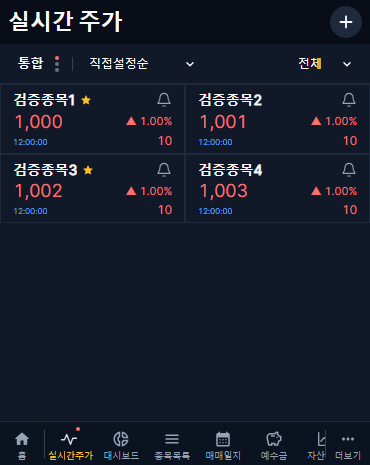
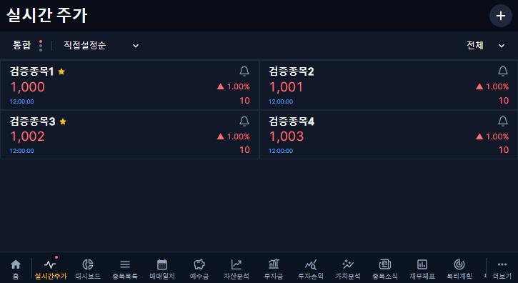

# 실시간 주가 제목·글자 간격 개선 · v1.2.53

## 변경 범위

최신 main cb8e184f 기준의 codex/live-quotes-title-spacing-20261031 브랜치에서 진행했다. 다른 재무 보완 PR과 기존 개인 작업 파일은 포함하지 않는다.

- 제목의 개별 16px 지정을 제거하고 대시보드와 같은 공통 헤더 글꼴·22px·700 굵기를 사용한다.
- 카드의 20/28/18px 고정 행 높이와 현재가 26px 줄 높이를 제거했다. 줄 높이 1과 숫자 글꼴 여백 정리로 보이는 텍스트 사이를 좁힌다.
- 세 행 사이 간격과 상하 내부 여백은 각각 8px이다. 시각과 등락액의 아래 맞춤, 기존 현재가 크기·전일 대비 색상·노란 보유 별·알림 아이콘은 유지한다.
- 숫자의 쉼표·한글이 잘리지 않도록 표시 범위를 보정했다. 텍스트 여백 정리가 지원되지 않는 브라우저도 줄 높이 1로 표시하며, 실제 렌더링된 높이를 드래그 판정에 사용한다.
- 카드 높이가 작아져도 롱프레스·상하 가장자리 자동 스크롤·드롭·취소·명시적 순서 저장을 유지한다. 편집 중 카드의 이동 애니메이션과 논리적 셀 판정은 기존 방식이다.

## 검증과 보호

프런트 타입 검사/빌드와 배포 범위 테스트 5건이 통과했다. 커버 370×465·태블릿 725×396에서 전체 실시간 화면 회귀 54건을 통과했다. 예전 카드 높이의 고정 좌표를 사용하던 빈 영역 클릭 검사는 현재 카드 내부 여백을 사용하도록 수정하고 두 화면에서 재검증했다. 렌더링 캡처로 한글·쉼표·글자 간격도 확인한다. 중간 카드 높이 조정에서 검출된 참조 누락은 최종 수정 후 재검증했다.

## 배포·복구

현재는 배포 준비 기록이며 실제 CI·병합·운영 검증 결과는 완료 후 추가한다. 배포 범위는 웹만이며 DB 마이그레이션·백엔드/수집기 코드·APK·과거 수집 정책 변경이 없다. 현재 운영 컨테이너·설정·웹 compose·버전 메타데이터는 비공개 복구 기준으로 보관했다.

문제가 있으면 직전 v1.2.52 웹 이미지 sha-5a8ef2f478b16b05ac0d7476e440d9dfa6fff1be와 보관한 compose/런타임 버전으로 웹만 복구한다. 운영 DB 복원이나 과거 대기열 초기화는 하지 않는다. 운영 확인에는 전용 임시 계정을 사용하고 종료 후 제거한다. 주말 신규 체결 수신이나 실기기 사용성은 이번 로컬 렌더링 검증과 구분한다.
