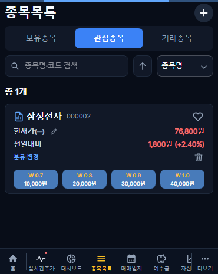
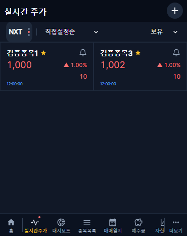
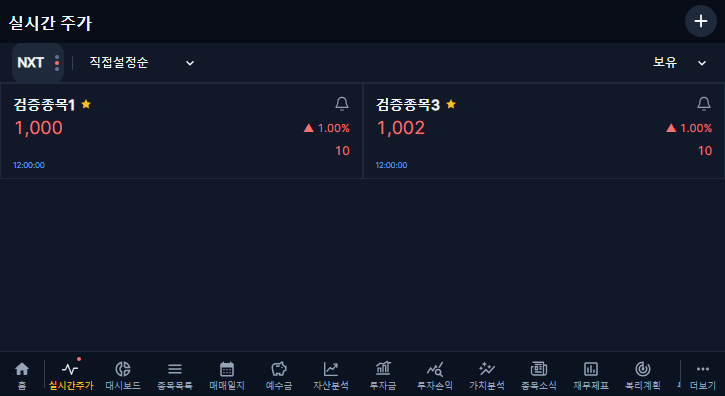

# 실시간 주가·표시 종목 관리·관심종목 개선 · 2026-10-31

## 변경 범위

기준 main 0a3906c248c02ad2fd47ace3b1773f9f024e83e8, 운영 v1.2.50에서 웹 버전 v1.2.51로 증가한다. 별도 codex/live-quotes-edge-scroll-20261030 브랜치이며 미병합 재무 보완·문서 PR은 포함하지 않는다. Android·재무 수집 정책·기존 개인 거래 자료·DB 구조는 변경하지 않는다.

- 롱프레스 드래그는 카드 영역을 기준으로 상하 가장자리에서 계속 스크롤한다. 경계 좌표를 보정하며 드롭 무저장·헤더 취소/저장·원래 순서 복원과 409 충돌 보호를 유지한다.
- 표시 목록 최대 50개를 화면과 서버에서 검증한다. 기존 50개 초과 목록은 강제로 자르지 않고 제거/재정렬만 허용한다. 한투 실제 공유 구독 한도 41과 표시 목록 한도 50은 다른 제한이며 기존 구독 거절/한도 상태를 유지한다.
- 통합→NXT→KRX 단일 고정 폭 전환, 옆 정렬, 우측 필터의 테두리 없는 공통 디자인. 시세 하단 HH:mm:ss만 표시하고 마지막/지연 시세는 회색이며 전체 상태는 접근성 이름과 툴팁에서 확인한다. 장외는 같은 시장의 마지막 값/수신 시각을 유지한다.
- 가격 변경 테두리는 직전 틱 방향이 아니라 현재 전일 대비 상승/하락 방향으로 통일한다. 기존 1초 최신값 반영·메모리 캐시·사용자/시장 분리·화면 전체 재로딩 방지를 보존한다.
- 표시 종목 관리는 체크/해제로 추가·제거를 임시 편집하고 상단 저장에서 한 번 반영한다. 취소는 마지막 저장 상태로 복원하며 저장 실패·동시 수정 시 편집 상태를 유지한다. 빈 목록 저장도 가능하다. 실제 보유·관심 등록·거래·예수금은 변경하지 않는다.
- 검색은 최초 100개와 100개 단위 더보기, 조건 변경 응답 분리·중복 요청 방지·실패 후 기존 목록 유지. 검색 탭의 전체 선택 제거, 다른 탭의 현재 조건 전체 선택은 임시 선택만 변경한다. 상단 동작 버튼과 하단 딤 선택 요약을 제공한다.
- 카드 전체 대신 종목명만 이동한다. 현재 계좌 보유/거래 종목은 종목 상세 요약, 관심/미등록 종목은 가치분석 상세로 이동하며 뒤로가기는 원 목록으로 복귀한다. 종목 상세의 공용 단건 조회를 추가하여 계좌 등록이 없어도 조회할 수 있다. 계좌 소유권 검증과 기존 투자 기록은 보존한다.
- 가치지표 팝업은 좌우 16px 여백으로 확대한다. 관심종목 카드의 PER/PBR/ROE 행은 서버 검증 적정주가 네 칸으로 교체하고 제목 없이 32px 높이·좁은 줄 간격으로 표시한다. 삭제/분류 변경은 가격 영역과 구분선으로 분리하고 분류 변경 왼쪽·삭제 오른쪽이다. 태블릿도 기존 표를 유지하며 네 가격 칸을 별도 행에 표시한다.
- 관심 목록 불일치 수정: 현재 계좌의 WATCHLIST/기존 RECOMMENDED만 관심 후보로 가져오고 실제 보유·거래 기록이 수기 분류보다 우선한다. 선택 계좌가 없으면 다른 계좌 관심을 합치지 않는다. 메인 필터와 추가 탭은 같은 판정을 사용한다.

## 검증

- API·공통 규칙 및 기존 도넛/백업 형식 테스트 24건 통과. 백엔드 TypeScript·프런트 TypeScript/빌드 통과. 기존 Vite 500kB 안내는 유지된다.
- 운영에서 복원한 로컬 DB의 활성 계좌 5개에서 종목목록과 실시간 관심 후보 ID 집합 일치, 읽기 전용 대조 완료. 개인 식별/종목 목록·원본 로그는 공개하지 않는다.
- 휴대폰 370×465 / 태블릿 725×396: 실시간·관리·이동 52건, 가치지표 팝업·관심 가격 6건 통과. 추가 기존 종목 회귀 35건 통과와 1건 범위 밖 생략. 오래된 기대값 3종(양 화면 6건)은 별도 원본 main에서 동일 실패를 재현한 후 현재 메뉴 18개·오류 문구·새 인증의 UI 메모리 초기화 정책에 맞춰 수정했고 6건 재검증 통과. 인증·메모리 보호 로직은 변경하지 않았다.

## 운영 반영·보호·복구

현재 문서는 배포 준비 기록이다. 최종 PR/커밋/배포 결과는 실제 완료 후 추가한다. 기존 백엔드·웹·수집기 이미지와 증분 시작점 및 폐기된 과거 대기열을 읽기 전용으로 대조한다. 운영 변경은 기존 잠금·백업이 있는 자동 배포 절차로 수행한다. 새 마이그레이션은 없으며 기존 기록을 초기화하거나 과거 재수집을 재개하지 않는다. APK는 유지한다.

백엔드/수집기는 배포 이력의 previous-images.txt·compose.yml과 scripts/rollback-production-component.sh로 선별 복구하며, 웹은 직전 v1.2.50 이미지 sha-2b37b02e12d65508c6c803447d4b43ff0f08a78d와 비공개 버전 메타데이터로 복원한다. DB 자동 복원은 하지 않는다. 표시 목록 편집은 사용자별 settings.liveQuotes만 기존 CAS 경로로 저장하며 다른 설정은 보존한다. 실시간 체결·초 단위 이력 테이블을 추가하지 않는다.

이번 배포 시점은 주말이므로 실제 신규 체결 수신은 장중 후속 확인 대상이다. 접속/구독 또는 마지막 가격 표시를 실제 신규 체결 수신 완료로 보고하지 않는다. 운영 확인에는 임시 검증 사용자만 사용하고 검증 후 계정·계좌·세션을 제거한다.

CI가 보유 상세 가격 갱신 회귀를 검출해 기존 useStocks 기본 조회 옵션을 복원했다. 새 공용 종목 단건 조회는 유지하며 기존 보유 상세의 focus/가격 갱신을 막지 않는다. 목표가·잔여 수량·툴팁 경계 6개 재현 검사를 커버·태블릿·큰 커버에서 통과했다. 이전 head의 실패를 성공으로 간주하지 않고 최종 head의 전체 CI를 다시 확인한다.

삭제한 관심종목 상세보기 버튼을 참조하던 financial-ui13-1 회귀는 W 0.8 가격 칸으로 진입하도록 수정했다. 적정주가 원천 응답이 빈 배열인 경우에도 네 지속계수 칸을 유지하고 값은 —로 표시한다. 수치를 임의 계산하거나 채우지 않는다.

빈 응답·새 가격 진입·카드 빈 영역 클릭·팝업·원 목록 복귀를 포함한 Phase14 전체 17검사(커버·태블릿·큰 화면) 통과. 관심 가격 래퍼의 불필요한 전파 차단을 제거해 기존 표 행 클릭도 유지했다.

가격 조회 실패 시 재시도 안내가 관심 행 높이를 늘리던 경계를 수정했다. 네 가격 칸 내부의 재시도 아이콘으로 오류·재시도는 보존하고 행 높이는 유지한다. 보유/관심/거래 실제 스크롤 복귀 6검사 통과.
