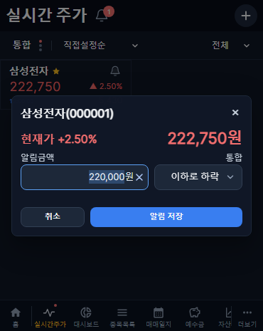
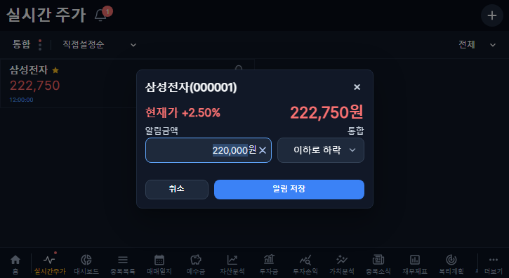
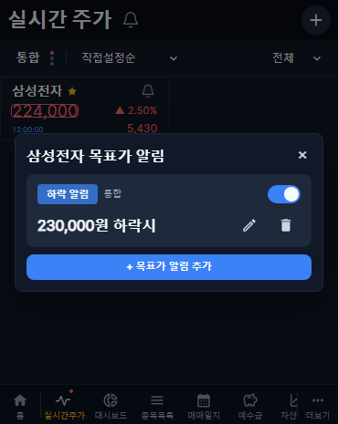
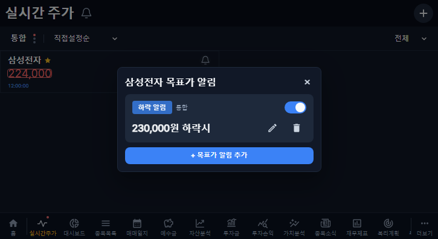
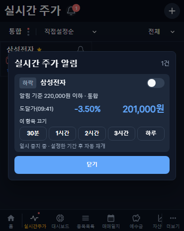
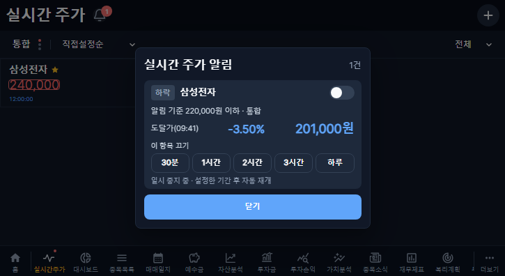

# 실시간 금액 알림 · V3.3 개발 검증

작성일: 2026-11-01 KST. 개발 버전: **1.2.55**. 기준 main: `d6d293c9` / 운영 버전 1.2.54.

## 범위와 배포 상태

실시간 주가에 사용자별 금액 조건, 등록 조건 관리, 미확인 도달 목록·배지를 구현했다. 로컬 DB의 새 테이블에만 마이그레이션을 적용했다. 운영 DB 변경·운영 배포는 수행하지 않았다. 검토용 draft PR이므로 저장소 자동 병합·배포 대상에서 제외된다.

Figma `5316:1329`, `5316:1795`, `5316:1819`, `5335:785`, `5316:2037`과 태블릿 `5316:2224` / `5316:2436`을 대조했다. 현재 일부 프레임 이름은 V3.4로 표시되지만, 충돌 시 이번 V3.3 요청문을 우선했다. 기존 기준 안내 줄은 넣지 않았고 일시 중지 선택지는 **30분·1시간·2시간·3시간·하루**다. 기존 메인 화면의 승인된 제목·카드 디자인은 유지했다. 운영 이미지의 공통 소스 복사 목록에 새 알림 정책을 포함했다. 태블릿의 명시적 보유 하위 화면은 기존 분할 배치를 유지하고, 일반 종목 상세 직접 진입에서는 뒤로가기를 제공한다.

## 변경된 동작

- 카드 종은 해당 종목의 조건 설정·관리, 제목 옆 종은 도달 목록이다. 배지는 등록 조건 수가 아닌 미확인 도달 건수이며 0은 숨기고 100 이상은 `99+`로 표시한다.
- 새 입력은 선택 시장의 확보된 현재가, 편집은 저장 금액을 사용한다. 실제 입력칸 포커스·전체 선택을 한 번 수행한다. 시세 갱신은 입력값·선택 범위를 바꾸지 않는다. 현재가가 없으면 빈 입력으로 열고 0원으로 대체하지 않는다.
- 공통 36px Small 폼을 사용한다. 양수 정수 원 금액만 허용하고 IME 조합 중 Enter·중복 제출을 차단한다. 저장 실패 시 입력과 기존 조건을 유지한다.
- 조건별 ON/OFF와 일시 중지를 별도 저장한다. OFF는 수동으로 켜야 해제된다. 하루 중지는 한국시간 다음 자정까지이며, 나머지는 선택 시점부터 계산한다.
- 정상 신규 KIS 체결만 판정한다. REST·캐시 복원, 거래정지, 휴장, 3초 이상 오래된 시세는 발생 근거로 사용하지 않는다. 저장·재활성화·중지 종료 자체로는 판정하지 않는다.
- 설정 시각과 같은 초의 모호한 체결은 보수적으로 건너뛴다. 이후 시각의 유효 신규 체결부터 판정하며, 동일 초 내 순서·재전송 구분에는 누적 거래량을 보조 식별자로 사용한다. KIS 공식 예제의 `ACML_VOL`은 0부터 센 13번 필드다. [공식 수신 필드](https://github.com/koreainvestment/open-trading-api/blob/main/examples_user/domestic_stock/domestic_stock_functions_ws.py)
- 조건당 열린 도달 항목은 1건이다. 반복 수신으로 발생 시각·도달가·등락률을 갱신하지 않는다. 확인 후에도 경계 상태를 보존하므로 조건 밖으로 나갔다가 다시 진입해야 재발생한다. OFF·중지·재시작으로 이 중복 방지 상태를 초기화하지 않는다.
- 카드 본문은 서버에서 해당 종목의 열린 항목을 확인한다. 화면 조회 후 새로 도달했거나 다른 세션에서 발생한 항목도 함께 처리하며 클라이언트의 오래된 이벤트 목록에 의존하지 않는다. 같은 종목 확인 요청은 진행 중 요청을 공유하므로 본문을 누른 직후 종목명을 눌러도 이동이 누락되지 않는다. 종목명은 확인 후 기존 요약/가치분석 이동 규칙을 따른다. 도달 목록 제목은 선택한 항목만 확인하고 현재 계좌·정확한 종목의 보유 현황으로 이동한다. 팝업 이력 소비 후 이동하므로 뒤로가기가 새 경로를 취소하지 않는다.
- 종·스위치·편집·삭제·중지 버튼 및 순서 드래그를 확인·이동과 분리했다. 터치 대상이 가까운 종목명 버튼으로 보정되는 경우에도 기존 롱프레스·끝 자동 스크롤을 유지한다. 커버 제목 종과 순서 편집 버튼의 겹침도 방지했다.

## 저장·서버 구성

새 개인 테이블은 `live_price_alerts`, `live_price_alert_events` 두 개다. 개인 백업과 사용자 범위 보호 목록에도 포함했다. 기존 재무·가치·거래·소식·오류 자료를 변경하는 SQL은 없다.

조건은 사용자·종목·기준 시장·방향·금액을 저장한다. 같은 활성 조건의 중복 등록은 거절한다. 조건 변경은 버전 비교로 동시 덮어쓰기를 막는다. 종목·시장 변경은 허용하지 않는다. 삭제는 soft delete이며 도달 이력은 확인 상태로 보존한다. 이벤트의 고유 열린 키와 조건 행 잠금이 재접속·복수 처리자의 중복 생성을 막는다.

기존 `KisLiveService`의 단일 공유 웹소켓·lease·인증을 재사용한다. 활성 조건은 브라우저 없이도 서버가 감시하고, 설정 변경은 즉시 및 5초 주기로 재확인한다. 기존 프로그램의 공유 구독 예산 41개 **시장·종목 조합**을 초과하는 활성화는 안내와 함께 거절한다. 같은 조합의 여러 사용자·조건은 중복 구독하지 않는다. 사용자당 등록 조건 상한은 200개다. 표시 목록 50개 제한과는 별개다.

체결마다 DB에 쓰지 않는다. 경계 전환·도달 발생·설정·확인 때만 저장하며 틱 이력을 만들지 않는다. 화면은 기존 SSE에서 알림 변경 신호를 받고 별도 알림 메타데이터만 갱신한다. 15초 조회는 알림 메타데이터의 복구 경로이며 주가 REST 반복 조회나 화면 전체 로딩이 아니다. 다른 시장의 기존 조건을 편집할 때도 기존 SSE 훅·공유 서버 연결로 그 시장의 시세만 사용한다.

인증·CSRF 및 사용자별 조건/이벤트 소유 검사를 적용했다. 읽기 응답의 감시 건수도 해당 사용자 기준이다. 재연결·수신 설정·구독 실패 상태를 숨기지 않고, 수신 불가 시 조건 저장과 실제 판정을 구분한다.

## 검증

- 타입 검사: 프런트·백엔드 통과.
- 빌드: 프런트·백엔드 통과. 기존 번들 크기 경고 외 실패 없음.
- 단위/회귀: 18개 통과. 금액·비교 경계, 지연/캐시 배제, 한국시간 자정, 기존 시세 파싱·구독/lease·표시 제한, 개인 백업 포함 검증.
- 실제 인증·별도 로컬 MariaDB 통합 테스트 통과. 미인증/CSRF/타 사용자 차단, 조건 중복, 최초 저장 무발생, 도달 1건·스냅샷 불변, 확인 후 재진입, 서버 재시작, 복수 처리자, OFF·버전 충돌·중지·삭제 이력·시장 구분·공유 예산을 검증했다.
- 브라우저: 신규 알림 16개 및 기존 실시간 화면 54개 통과. 커버 370×465, 태블릿 725×396. 입력 포커스·선택 유지·오류 재시도·IME·다중 제출, 다른 기준 시장, 99+·선택 확인·보유 화면 이동, 드래그·정렬·끝 자동 스크롤·종목 관리 회귀를 확인했다.
- 로컬 마이그레이션 전후 기존 재무·거래·사용자·계좌·현금·소식 등 10개 테이블의 행 수가 동일함을 확인했다. 새 조건·이벤트는 0건이며 화면 예시를 실제 개인 자료에 저장하지 않았다.

## 실행 화면

아래는 브라우저 테스트의 명시적인 가상 시세·가상 종목 응답이다. 운영 데이터가 아니다.

| 상태 | 커버 | 태블릿 |
|---|---|---|
| 기존 금액 전체 선택 편집 |  |  |
| 등록 관리 |  |  |
| 도달 목록·조건 OFF·2시간 중지 |  |  |

## 지원 범위와 남은 확인

**서버 감시·앱 내 목록/배지는 지원하며 휴대폰 OS 푸시·FCM 전송은 추가하지 않았다.** 백엔드와 정상 KIS 연결이 계속 실행되는 동안 브라우저를 닫아도 감시·도달 저장은 지속된다. 앱이 정지된 동안 휴대폰 알림창에 즉시 전달하지는 않으며 재접속 시 저장된 도달 목록을 조회한다.

2026-11-01은 일요일이다. 실제 장중 체결에 의한 새 조건 발생과 휴대폰의 실제 소프트 키보드는 추가 실기기 확인 대상이다. 신규 시세 판정은 실제 수신 형식의 재생·격리 DB 검사로 검증했으며 장중 실수신 검증으로 표현하지 않았다. 로컬은 운영 키의 중복 세션을 피하도록 KIS 연결을 비활성화한 채 실행한다.

처리 대기열 초과·저장 오류는 감시 이상 상태로 표시한다. 이런 경우 도달 보장을 주장하지 않는다. 고빈도 운영 부하에 대한 별도 장중 관찰이 필요하다.

운영 적용 시에는 기존 절차대로 백업 후 추가 마이그레이션·백엔드/웹 배포·장중 확인을 수행한다. 되돌릴 경우 이전 서비스 이미지로 복귀하고 새 테이블·이력은 보존한다. 과거 재무 수집·보완 작업을 재개하는 변경은 없다.
