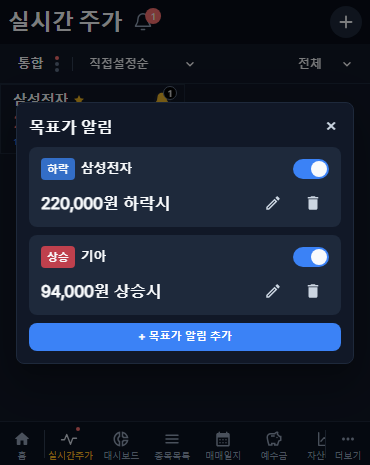
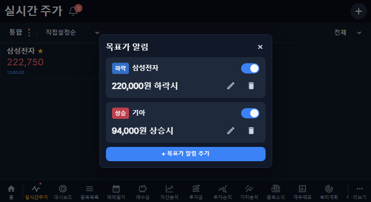
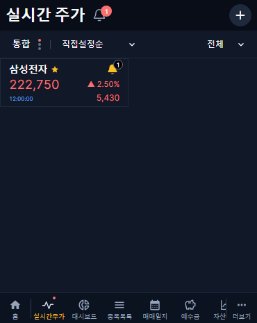
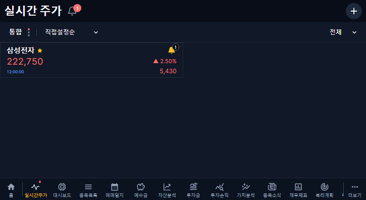

# 목표가 알림 목록 통합·등록 배지 · v1.2.56

## 변경

- 종목 카드의 종 아이콘은 모두 같은 `목표가 알림` 관리 팝업을 연다. 로그인 사용자에게 등록된 모든 종목·시장의 조건을 함께 표시한다.
- 목록 첫 줄은 `상승/하락` 배지·종목명·스위치다. 목록의 시장 문구는 제거하고, 금액·편집·삭제·일시 중지 안내는 유지한다.
- 다른 종목의 조건을 편집할 때 해당 조건의 종목 식별자·시장으로 편집한다. 저장·취소 후 통합 목록으로 돌아온다. 추가는 진입한 종목을 기본으로 하며 기존 시장 기준을 유지한다.
- 등록 조건이 있는 종목은 노란 채움 종과 등록 개수 배지로 표시한다. OFF·일시 중지도 등록 개수에 포함하며 다른 종목은 합산하지 않는다. 0개는 윤곽 종·배지 숨김, 99개 초과는 `99+`다.
- 배지는 검정 배경·흰 숫자·회색 `#64748B` 테두리다. 제목의 미확인 도달 개수와 독립적으로 집계한다. 드래그 복제 카드도 같은 등록 상태를 표시한다.

## 데이터·보호

DB 마이그레이션·조건 재작성은 없다. 기존 사용자별 조회·검증·저장 경로를 재사용한다. 조건의 시장·금액·ON/OFF·일시 중지·발생 및 확인 정책과 기존 투자 기록을 변경하지 않는다. 과거 재무 수집·대기열 재개는 없다. APK 변경 없음.

## 검증

- 웹 타입 검사·운영 빌드 통과.
- 커버 370×465·태블릿 725×396 알림 테스트 20개 통과: 통합 목록, 다른 종목·시장 편집, 입력 유지, 삭제, ON/OFF, 도달 목록, 사용자 확인 이동, 등록·도달 배지 분리.
- 기존 실시간 화면 회귀 검사 54개 통과: 드래그·자동 스크롤·순서 저장·시장/필터 전환·표시 목록 관리·시세 보존·종목 이동.
- 아래 이미지는 자동화 검증용 예시 자료이며 운영 데이터가 아니다.

| 화면 | 커버 | 태블릿 |
|---|---|---|
| 통합 목록 |  |  |
| 채움 종·배지 |  |  |

## 운영 확인 계획

검사·병합 후 기존 배포 절차로 반영한다. 검증 전용 계정으로 여러 종목의 등록 조건이 한 목록에 보이는지, 다른 종목 조건 편집·사용 여부·재접속 유지와 아이콘·배지를 대조한다. 기존 사용자 조건은 수정하지 않는다. 실패 시 이전 이미지로 복귀할 수 있으며 새 DB 변경은 없다. 실제 신규 체결에 따른 도달 검증은 장중 확인과 구분한다.
