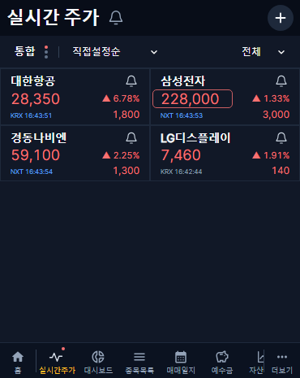
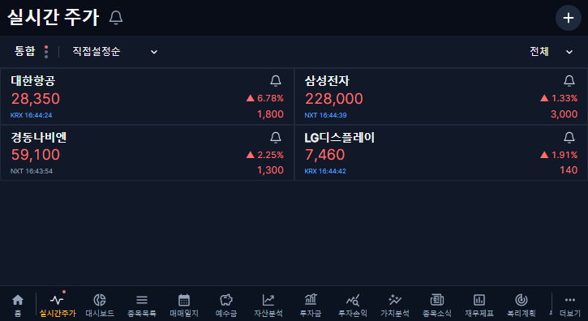

# KRX/NXT pair subscriptions and internal automatic view

Release: 1.2.60. Replaces the 1.2.59 physical TOTAL/fallback subscription policy.

## Behavior

- Registration stays limited to 20 symbols. Every requested symbol has one shared KRX/NXT pair, irrespective of screen market or alert market. Twenty distinct symbols consume 40 of the 41 global slots. An entire additional pair is rejected explicitly; a partial pair is never silently admitted.
- Provider TOTAL subscriptions are forbidden at the socket command boundary. The UI TOTAL value is an internal alias of one complete physical quote, with its source market and genuine timestamp preserved.
- Regular session prefers fresh KRX; extended session prefers fresh NXT. A fresh alternate venue can fill an unavailable/stale preferred venue. Without a fresh trade, keep the most recent genuine trade and its status; do not relabel old values as live.
- Direct KRX/NXT views retain their exact market values. Switching views or crossing a session boundary does not recreate physical subscriptions. Physical sequence counters are never compared across venues.
- Alert conditions keep their saved logical market; automatic conditions follow the same quote selection. No tick history or additional per-second DB writes.

## Local verification

- Shared, backend and collector TypeScript checks passed; frontend production build passed.
- Policy, socket, API and alert domain tests: 22 passed. Includes 40-slot budget, no physical TOTAL command, reconnect, replay protection, direct-view isolation and session selection.
- Alert DB integration: 1 passed using the dedicated local test database.
- Cover/tablet quote browser regressions: 62 passed; alert browser regressions: 22 passed.

## Deployment protection

No schema, credentials, user investment data or historical collection policy change. Before deployment, preserve the previous runtime configuration/image references and compare collection boundaries, retired task counts and alert configuration digests. The deployment pipeline creates and verifies a server-local SQL.GZ backup. Code rollback uses prior images/configuration without restoring the DB over new records.

## Production completion

- Code [PR #390](https://github.com/byungho-cho/roxstock/pull/390), merge `7ddfda553a86511bd030c176b6bcb8efebeda1d5`.
- [Production workflow](https://github.com/byungho-cho/roxstock/actions/runs/41406940993) succeeded after required checks. Backend started 2026-11-02 16:40:25 KST; all collector roles started 16:47:15 KST. Public version API returns 1.2.60. All five containers were healthy at 16:48:15 KST.
- Backend and collector images use the merge SHA. Frontend remains the unchanged 1.2.59 image: this release changes server/shared policy only, and the deployment scope correctly skipped frontend and Android.
- Server-local pre-deployment SQL.GZ backup was verified at `/opt/roxstock/backups/roxstock-v0.2-20261102T073848Z/roxstock-v0.2-20261102T073848Z.sql.gz`. Previous images/runtime configuration were preserved privately; no secrets are included here.
- Existing server SSE stream was used, without opening a second KIS session. Production tests passed all 21 assertions: 20 registrations accepted/persisted, 21 rejected without mutation, four genuine KIS quotes on both layouts, policy `krx-nxt-v2`, source markets restricted to KRX/NXT, budget at most 41, direct NXT reception, and no browser errors. The temporary QA user/account/session were removed.
- Actual automatic-view reception: Samsung Electronics NXT at 16:43:53, Korean Air KRX at 16:43:51, Kyungdong Navien NXT at 16:43:54, and LG Display KRX at 16:42:44 KST. Tablet observations also confirmed all four. Direct Samsung NXT trade at 16:44:56 KST was received. These are observed public trades, not stored fixtures.
- Automatic selection preferred NXT where fresh during extended trading and retained fresh KRX fallback where applicable. Regular-session KRX priority, closed/session transitions, unsupported/stale alternatives and reconnection were verified locally; the new deployment was not observed during the regular session itself.
- Collection boundary remains 20261028; retired historical queue status counts are unchanged. The five existing alert configurations and two existing event records have identical before/after digests. No historical collection was resumed, credentials changed, tick history added or investment records modified.

### Production captures (temporary QA account)

