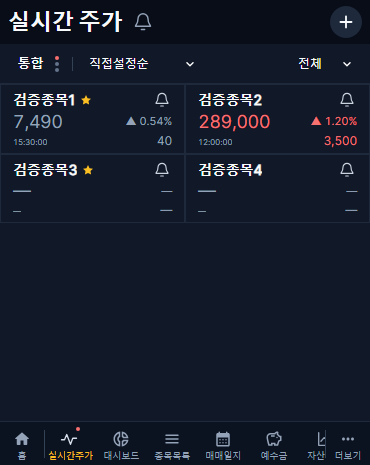
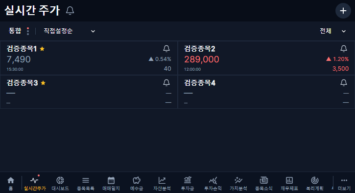
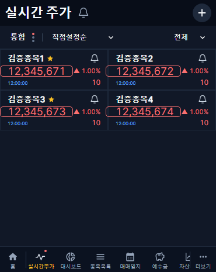
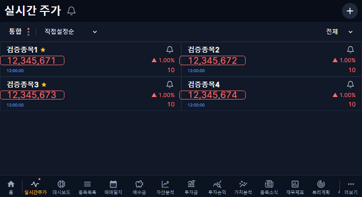

# 실시간 주가 V3.8 · 강조 여백·미수신 표시

로컬 구현·검증 완료. 운영 배포는 수행하지 않았다. Figma V3.8의 강조 샘플 `5370:746`과 태블릿 `5280:2`를 대조했으며, 기존 폰트·간격·행 높이·알림 아이콘은 사용자 요청대로 유지했다.

- 가격 텍스트의 가상 요소에 좌우 16px·상하 2px 여백과 1px 외곽선을 적용했다. 레이아웃을 차지하지 않으며 pointer-events는 none이다. 기존 전일 대비 강조색과 1초 표시·220ms 페이드는 유지한다.
- 화면 가장자리 또는 긴 금액 옆 등락률에 닿으면 수평 확장 폭만 제한한다. 이 경우 16px보다 작아질 수 있으며 텍스트 이동·글꼴 축소·카드 크기 변경으로 공간을 확보하지 않는다.
- 종목·시장 일치, KIS 출처, 한국 날짜 기준 당일 체결·수신 기록을 확인해야 정상 수신으로 표시한다. 연결 성공·REST 종가·다른 시장·전일 시세만으로 정상 수신으로 바꾸지 않는다. 당일 이미 수신했던 정상 값은 재진입 시에도 유지한다.
- 미수신의 현재가·등락률·등락 금액·시간은 기존 textMuted 토큰이다. 강조는 숨긴다. 정상 값이 오면 기존 색상과 실제 시각으로 복원하며 최초 값은 변동으로 강조하지 않는다.
- 저장 시세의 HTTP 조회 시각을 실제 시세 시각으로 표시하지 않는다. 없는 값은 —, 0·음수·유효하지 않은 시각의 수신값은 무시하고 마지막 정상 값이 있으면 보존한다.
- DB·수집기·API·운영 알림·개인 투자 데이터 변경과 새로운 주기적 조회는 없다.

검증: 웹 타입 검사·빌드, 커버 370×465 및 태블릿 725×396의 새 상태/기하 검사 6개와 기존 실시간 회귀 54개, 합계 60개 통과. 마지막 검증 화면에서 위치·테두리·미수신 색상을 확인했다. 검증용 금액·시각은 운영에 저장하지 않았다.

| 상태 | 커버 | 태블릿 |
|---|---|---|
| 미수신·종목별 정상 수신 |  |  |
| 긴 금액 강조 |  |  |

## 추가 요청 · 일시 중지 시 도달 목록 제거

도달 목록의 30분·1시간·2시간·3시간·하루 버튼은 선택한 조건을 일시 중지하면서 해당 도달 항목만 확인 처리한다. 목록과 제목 배지가 함께 갱신된다. 등록 조건·다른 조건의 도달 항목·원본 발생 이력은 보존한다.

기존 PATCH 요청에 선택적 `acknowledgeEventId`를 추가했다. 일시 중지와만 함께 허용하며 사용자·조건·도달 ID·설정 버전을 확인한다. 두 상태는 같은 DB 트랜잭션에서 저장해 실패 시 모두 유지한다. OFF 상태와 일시 중지 기간 종료 후 자동 재개 정책은 변경하지 않는다. DB 스키마 변경은 없다.

검증: 알림 UI 22개 통과(5개 기간·선택 항목 제거·다른 항목 및 조건 유지·실패 시 유지). 전용 로컬 시험 DB의 실제 인증/트랜잭션 통합 검사 통과(타 사용자 및 다른 조건의 도달 ID 차단·잘못된 기간 롤백·이력 보존). 프런트 및 백엔드 타입 검사 통과. 운영에는 미반영이다.
