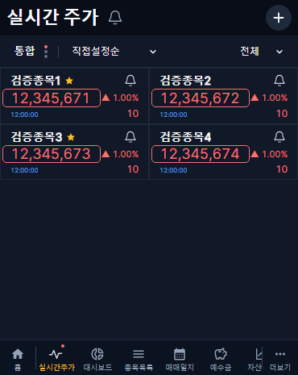
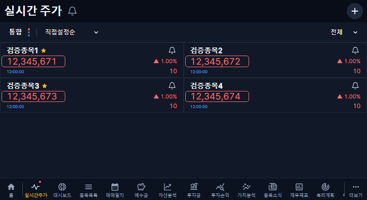

# 가격 강조 테두리 카드 내부 여백 · v1.2.58

## 변경

- 텍스트 위·아래 강조 여백을 각각 2px에서 4px로 늘린다.
- 화면 전체의 왼쪽 경계 대신 각 종목 카드의 안쪽 왼쪽 경계를 기준으로 제한한다. 1px 외곽선 자체가 카드 안쪽 선에서 최소 2px 떨어진다. 왼쪽·오른쪽 열에 같은 규칙을 적용한다.
- 좌우 기본 확장 16px와 등락률 간섭 방지, 가격·시간 위치·글꼴·행 간격·카드 크기·색상·강조 시간·pointer-events none은 유지한다.
- 알림 조건·도달 이력·시세 수신·수집기·DB 스키마·APK 변경은 없다. 이번 배포 대상은 웹과 표시 버전이다.

## 검증

커버 370×465와 태블릿 725×396에서 가상 요소의 top/bottom -4px, 실제 1px 선과 카드 안쪽 경계 사이 2px 이상, 양쪽 열의 모든 카드, 강조 전후 위치 불변, 긴 금액과 등락률 분리를 확인한다. 새 기능이 추가된 변경이 아니라 기존 기하 검증을 요청한 기준으로 갱신했다.

웹 타입 검사·빌드 및 실시간 화면 회귀 60개를 통과했다.

| 커버 | 태블릿 |
|---|---|
|  |  |

이미지는 자동화 검증용 예시이며 운영 값으로 저장하지 않는다. 운영 결과는 배포 후 기록한다.
