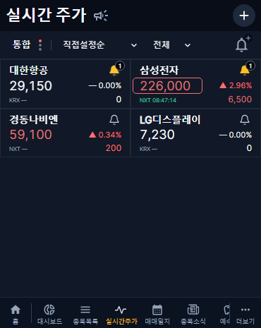
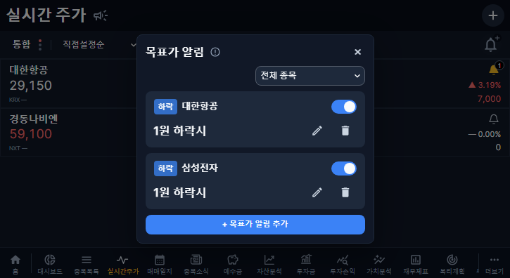

# Live quote colors, target alert management and menu notifications

Release 1.2.61. Implementation, required CI, production deployment and production verification completed.

- Price, daily change and rate keep their daily rise/fall/flat color before and after sessions. Genuine live timestamps use the green token; closed, waiting, retained and delayed values use muted timestamps. Unknown REST quote timestamps display a dash, and a REST seed cannot overwrite a genuine last trade.
- Target alert manager has a right-aligned symbol filter. Card bells open the selected symbol; the toolbar bell-plus opens all conditions and lets the user choose a displayed/saved-condition symbol for a new alert. The title announcement icon opens arrivals. Monitor notices moved to the existing clickable explanation component; action errors remain visible.
- Both bottom navigation and More use Home, Dashboard, Stocks, Live Quotes, Journal, Stock News, Cash, followed by the remaining existing entries. The static live-menu red dot is removed. Bottom Live Quotes and Stock News show a 7px red dot only for real unacknowledged arrivals/unread news.
- Alert status shares the existing user-scoped query/cache. News status uses a private, account-scoped boolean endpoint that selects at most one unread ID, without loading article bodies or triggering collection. Confirmed read actions invalidate this status. No schema or tick-history storage change.
- The temporary preview override and query-parameter handler were removed entirely. Old preview URLs cannot force indicators.
- The public live-menu SVG URL has a new revision parameter, so clients with the previous seven-day immutable icon cache also receive the version without the fixed dot.

## Validation

- Quote browser suite: 64 passed, cover/tablet.
- Target alert browser suite: 26 passed, cover/tablet, including scoped manager/addition and real-arrival menu-dot clearing.
- News read/layout browser suite: 20 passed, cover/tablet, including menu-dot clearing after confirmed bulk reads.
- Policy/socket/API/alert domain tests: 22 passed.
- Shared, backend and collector TypeScript checks; frontend production build; diff checks passed.
- Dedicated local news-read DB integration passed, including unread status, ownership isolation and persistence. Existing alert DB integration also passed during this change set.
- Additional shared menu checks (10), production-build performance checks (34), cached-profit checks (2), four-size asset error/retry checks (4), and focused legacy home-loading checks (2) passed. Page-bootstrap request limits remain intact; menu status requests are explicitly bounded. The menu observes account metadata without issuing an extra page bootstrap, and the alert cache prevents duplicate reads on quick remounts.

## Deployment preparation

Previous image/runtime references and before-state digests were preserved privately. Required CI and the production pipeline must finish before recording success. The pipeline verifies its server-local SQL.GZ backup. Rollback uses the preserved images/configuration, without overwriting subsequent valid DB writes. Historical collection boundaries/retired queues and existing alert configuration/event digests will be compared after deployment. No past collection is resumed.

## Production result — 2026-11-04 KST

- Code PR: [#392](https://github.com/byungho-cho/roxstock/pull/392), merged at 08:07:44 KST. Release commit: `390be6bc9d12031b7ed4edbe3402c9f1ab839d9c`.
- [Production deployment](https://github.com/byungho-cho/roxstock/actions/runs/41736643125) completed successfully. Backend started at 08:14:34, collector roles at 08:21:07–08:21:08, frontend at 08:45:29 KST. All five containers were healthy and used the release commit images at the 08:47:25 check. Public version API returned 1.2.61.
- Server-local SQL.GZ backup was verified before migration: `/opt/roxstock/backups/roxstock-v0.2-20261103T231313Z/roxstock-v0.2-20261103T231313Z.sql.gz`. No schema change was required.
- Final PR checks: 34 success, 6 intentionally skipped, no failures. An earlier empty-dashboard one-pixel geometry failure and a final-head search/sort timing failure passed unchanged-code job reruns after focused local reproduction checks (4 and 12 passes respectively); neither product behavior nor test tolerances were weakened. A separate full news/profit rerun passed all 18 tests while deployment checks were running. Deployment's full UI check also passed.
- Authenticated production UI checks passed at 370×465 and 725×396. Verified exact menu order, absence of both new-item dots for a user with no pending items even with the old `previewMenuBadges=1` URL, cache-revised icon URL, static SVG without a circle, announcement SVG, all/single-symbol alert manager, explanation tooltip and symbol selection when adding. No browser errors were observed.
- Existing production SSE was used; no additional KIS WebSocket session was opened. All four test symbols received a latest-value response and the physical market sources were KRX/NXT within the existing subscription budget. Samsung Electronics NXT genuinely received LIVE KIS quotes at 08:47:14 and 08:47:15 KST; daily rise color and green live time were verified. Korean Air, Kyungdong Navien and LG Display had CACHE/WAITING_TRADE values in this short observation: their numeric daily colors were retained and unknown REST trade times displayed a dash. These three samples do not establish live-trade reception for those symbols. Closed/delayed time states were verified by the local quote suite.
- Test conditions were clearly synthetic 1-won conditions under a nonce-owned temporary user/account, with no buys/cash records or fake market events. Both QA attempts cleaned up their temporary users, conditions and account data. The initial QA assertion incorrectly expected a development-only MUI `data-testid`; it was corrected to compare the actual production SVG path, and the full subsequent QA passed.
- After cleanup, existing condition count (5) and event count (2), and both before/after digests matched exactly. Historical coverage remained `20261028`; all retired backfill queue counts remained identical. Existing KIS token-cache mounts were preserved. No historical queue was resumed.

Production screenshots contain only temporary QA account/public quote data; the 1-won conditions are test data and were removed:

