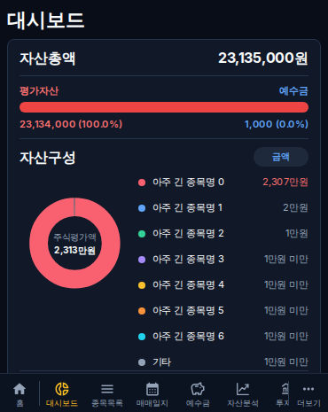
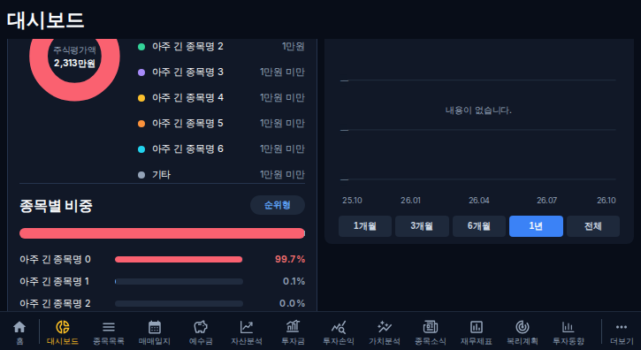
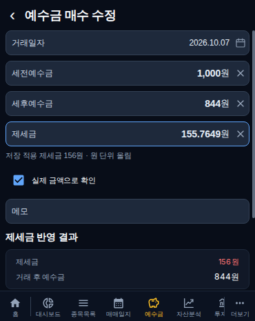
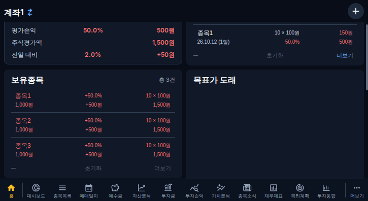
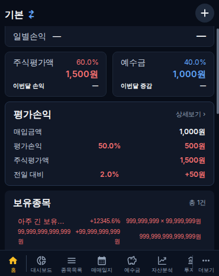
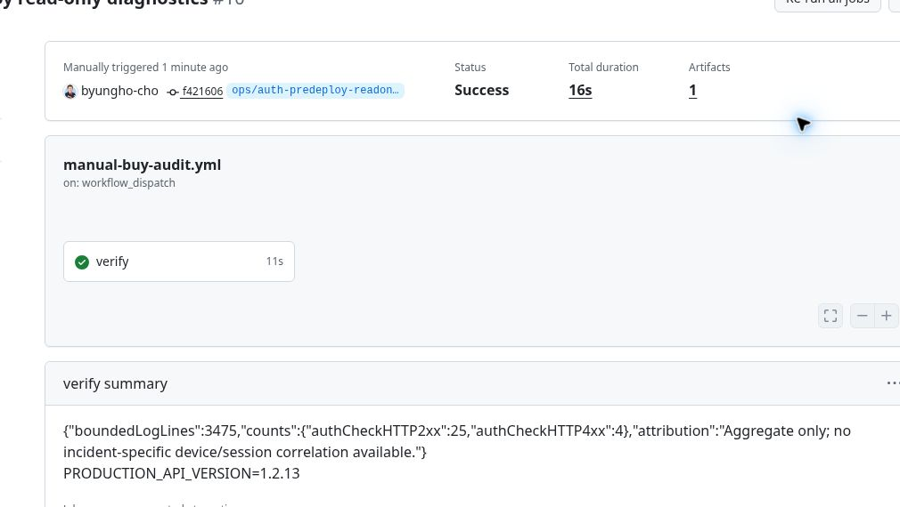
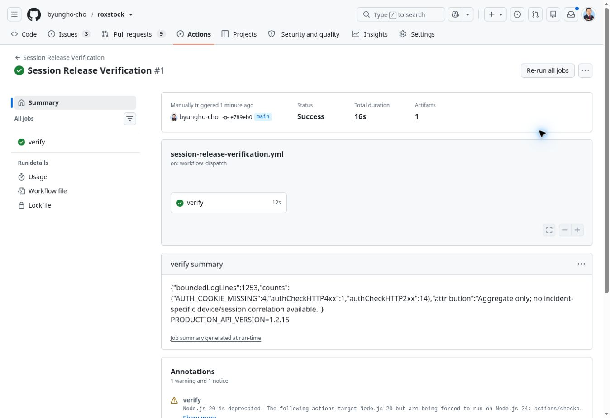

# 제세금·대시보드·홈 보유종목·자동 로그인 개선 결과

웹/API 최종 **1.2.15**(후속 패치). 1차 1.2.14 구현 PR [#313](https://github.com/byungho-cho/roxstock/pull/313), 검증 head `e6b00d19d9e4c2d649937292c71c748e62bd4c22`, 병합 `b4d9a6b3920ae3ba5cb2158cfb94ef43e3696d98`.

최신 기능 main의 PR #311(1.2.13)과 문서 PR #312(main `a50238fe`)를 대조하고 별도 브랜치 `fix/cash-dashboard-session-20261023`에서 작업했다. PR #311의 비용 확인 체크·시스템/통합 알림·가치지표 연결·투자동향과 34차 개선을 보존했다. 열린 다른 PR의 문서 작업은 이번 구현에 섞지 않았다.

운영 배포: **1차 및 후속 모두 성공·실제 반영 완료**. [1차 배포](https://github.com/byungho-cho/roxstock/actions/runs/39905770519) · [최종 배포](https://github.com/byungho-cho/roxstock/actions/runs/39910613189). 운영 확인 시각: **2026-10-23 15:34 KST**. 1차 배포는 2026-10-23 14:53 KST 웹/API healthy와 공개1.2.14를 확인했다. 최종 후속 배포 결과는 아래에 별도 기록한다.

## 변경 구조

### KRW 제세금과 잔액

`weightedFee`는 최근 3건의 가중 비용률 중간 계산에 60자리 정밀도를 사용하고 최종 비용에 한 번만 원 단위 올림한다. 매수/매도 생성 및 예수금 명시 저장 API도 정수 비용을 사용한다. `155.7649 → 156`, `155.0000 → 155`, `0 → 0`이며 빈 값·음수는 기존 입력 검증을 따른다.

예수금 편집은 소수 입력과 저장 적용액을 함께 안내하고 blur 시 정규화한다. 반영 결과·세후예수금·요청/저장값은 적용된 정수 비용을 기준으로 한다. 기존 소수 내역은 읽기/열기만으로 수정되지 않으며 초안과 적용액을 확인한 뒤 사용자가 저장해야 바뀐다. 동일 저장을 반복해도 같은 값을 대입하므로 추가 차감하지 않는다. 비용 확인 체크, 명시적 해제, 늦은 추정값의 입력 덮어쓰기 방지, 거래 중복 방지를 유지했다.

현행 예수금 계좌는 통화 필드가 없는 KRW 전용이다. 재무제표 외화·배당 비용·수량·단가·거래금액 등 다른 금액 항목의 정밀도는 변경하지 않았다. 세전 잔액에 원래 소수가 있다면 그 소수까지 임의로 정수화하지 않는다. 과거 비용·잔액·이후 내역·스냅샷을 일괄 재작성하지 않는다.

### 자산구성 범례

기존 ‘순위형’과 같은 스타일의 비율/금액 버튼을 제목 오른쪽에 추가했다. 기본은 비율이고 범례 숫자만 전환한다. 실제 평가금액을 만원 정수로 반올림해 쉼표/만원을 표시하며 양수 1만원 미만은 `1만원 미만`으로 표시한다.

기존 상위 7종목/기타 집합, 순서·8색·비중·도넛 중앙 총액을 재사용한다. 기타 금액도 포함 종목의 평가액 합계이며 예수금은 포함하지 않는다. 원본 평가액을 변경하지 않고 전환에 API 재조회나 차트 재생성이 없으며 자동 갱신에도 선택을 유지한다.

### 홈 보유종목

| 열 | 첫째 줄 | 둘째 줄 |
|---|---|---|
| 왼쪽 | 종목명 | 매입금액 |
| 가운데 | 평가손익률 | 평가손익금액 |
| 오른쪽 | 보유수량 × 평균매수단가 | 현재 평가금액 |

숫자는 각 열 안에서 우측 정렬하고 기존 금액 형식·손익 색상·클릭을 유지했다. 긴 종목명은 말줄임하고 큰 숫자는 제한된 열 안에서 줄바꿈한다. 최근 매수·목표가 도래 행의 열 배치는 바꾸지 않았다.

## 자동 로그인: 확인된 코드 경로와 실기기 원인 구분

확인·재현한 코드 문제:

- 기존 AuthGate의 모든 예외 catch가 사용자·쿼리 캐시·알림 소유자를 해제했다. 네트워크 단절·5xx·잘못된 응답만으로도 로그인 화면 전환이 가능했다.
- 기존 서버는 유예가 지난 은퇴 토큰 요청 하나로 세션 행 전체를 철회했다. 정상 최신 쿠키를 가진 요청도 이후 거부됐다. 기존 실DB 테스트의 기대값도 이 동작이었다.
- 매 갱신 토큰을 교체하는 방식은 늦은 Set-Cookie 응답이 새 토큰이나 다른 탭의 새 로그인 쿠키를 덮어쓰는 경쟁 조건을 만들 수 있었다.

수정한 정책:

- 인증 확인은 요청당 15초 제한, 알려진 서버 401 세션 코드와 일시 오류를 구분한다. 자동 재시도는 2/5/15초 간격 최대 3회이며 수동·온라인 복구·화면 복귀 확인도 지원한다.
- 검증된 기존 사용자의 일시 오류에는 사용자·계좌·캐시·알림 연결을 유지하고 연결 안내를 표시한다. 최초 미확인/사용자 전환은 개인 화면을 렌더링하지 않는다. 사용자/역할 변경을 확인하면 기존 개인 캐시를 비우며, 네이티브 소유자 해제가 실패한 전환도 화면을 차단한 채 재시도한다.
- 단순 권한 부족 403은 전체 로그아웃 근거가 아니다. 응답 순번으로 오래된 사용자 응답을 무시하며 초기 중복 확인을 방지한다. 네이티브 응답 대기 뒤에도 순번을 검사해 최신 인증이 지워지지 않게 한다.
- `/me` 활동 확인과 `/refresh`는 현재 유효 토큰을 유지하면서 자동 로그인 90일/일반 12시간 만료를 연장한다. 새 로그인마다 독립 난수 토큰을 발급한다. 갱신마다 토큰을 바꾸지 않으므로 같은 세션의 역순 갱신 응답도 같은 쿠키를 설정한다.
- 쿠키를 쓰는 인증 요청은 같은 출처의 Web Locks로 탭 간 직렬화한다. Web Locks 미지원 환경은 문서 내 Promise 순서만 보장하며 구형 다중 탭 환경의 탭 간 순서는 보장하지 못한다.
- 배포 전 은퇴 토큰은 원래 유예까지만 허용하고, 이후 해당 요청을 거부하되 정상 현재 세션을 철회하지 않는다. 모든 요청의 DB 만료·철회·인증 상태, HttpOnly/Secure/SameSite/CSRF·소유권 검증, 비밀번호 변경/초기화·명시적 로그아웃의 서버 철회는 유지한다. 비밀번호를 클라이언트에 저장하지 않는다.

오류 코드는 쿠키 누락/형식, 세션 없음/만료/철회, 미인증 사용자, 토큰 불일치/은퇴, 임시 인증 만료를 구분한다. 클라이언트는 통신/시간 초과/응답 오류를 구분한다. 로그에는 고정 분류와 건수만 남기며 비밀번호·토큰·쿠키 원문은 출력하지 않는다.

### 운영 로그 조사

배포 전 **2026-10-23 14:12 KST** 읽기 전용 [진단 실행](https://github.com/byungho-cho/roxstock/actions/runs/39904460237)에서 최근 최대 7일/10,000줄을 요청했고 현재 backend 컨테이너의 **3,475줄**을 확인했다. 인증 확인 요청은 **2xx 25건, 4xx 4건**, 이 범위에서 5xx는 관측되지 않았다. 4xx를 실제 세션 만료로 단정하지 않는다. 이전 로그에는 원인 코드·기기 사건 상관 정보가 없으며 nginx/기기 네트워크 오류는 이 backend 집계에 포함되지 않는다.

진단은 운영 변경 없이 별도 `ops/auth-predeploy-readonly-20261023`의 검증된 읽기 전용 정의로 실행했다. 이 운영 분기의 임시 실행 정의는 main에 병합하지 않았고 기존 매수 조사 workflow의 main 파일도 변경하지 않았다. 원문 로그 대신 비식별 집계 artifact만 14일 보관한다.

배포 후 진단: **읽기 전용 [진단 #1](https://github.com/byungho-cho/roxstock/actions/runs/39912272106) 성공(16초), 공개 API1.2.15 확인. 현재 backend 컨테이너 로그1,253줄에서 인증 확인2xx14건·4xx1건, 고정 코드 `AUTH_COOKIE_MISSING`4건. 코드 집계와 me/refresh HTTP 집계는 서로 다른 단위이며 합산하지 않는다. 제어된 비로그인 확인도 포함될 수 있어 사용자 사건의 건수나 원인으로 귀속하지 않는다. 배포 전/후 컨테이너의 로그 범위가 다르므로 전후 장애율 비교도 하지 않는다. 원문 로그를 공개하지 않고 집계 artifact만14일 보존**.

**이번 실기기 사례의 직접 원인은 미확정**이다. 위 코드 문제를 확인·수정한 사실과 특정 사용자 사건의 원인 확정은 구분한다.

후속 [PR #314](https://github.com/byungho-cho/roxstock/pull/314), 검증 head `03b57ed176d20286c754e5814ee223fcc468c668`, 병합 `e789eb0e0e7633976ec648c9d3c3883d3da25621`, [운영 배포](https://github.com/byungho-cho/roxstock/actions/runs/39910613189): 이전 인증 실패의 네이티브 응답이 지연되는 동안 새 인증 확인이 성공하면, 그 응답 이후에도 순번을 다시 검사한다. 수정 전 동일/다른 최신 사용자 × 커버/태블릿 4건 모두 최신 상태가 비워지는 현상을 재현했다. 수정 후 이 4건과 기존 관련 회귀를 합친 10건 및 타입 검사가 로컬 통과했다. Java 브리지의 소유자 해제는 동기적으로 수행되고 응답이 돌아오므로 이번 보완은 늦은 응답의 웹 상태 변경을 차단한다. 네이티브 코드는 변경하지 않았다.

## 검증 결과

1차 head의 [PR Validation](https://github.com/byungho-cho/roxstock/actions/runs/39903670070) 및 관련 **32개 workflow 성공, 6개 조건부 skip**, 실패 없음. 후속 PR #314의 [PR Validation](https://github.com/byungho-cho/roxstock/actions/runs/39908594026) 및 선택된 workflow **28개 성공, 6개 조건부 skip**도 병합 전 확인했다. 건너뛴 APK/변경 서비스 등은 실제 실행 검증으로 세지 않는다.

| 구분 | 실제 확인한 결과 |
|---|---|
| 타입·빌드 | 프론트/백엔드 타입 및 빌드 통과 |
| 백엔드 단위 | 150건 통과. 실DB 전용 선언 1건은 일반 단위 실행에서 skip 후 별도 실행 |
| 실제 MariaDB 인증 | 인증 보안 assertion 102개 통과. 쿠키 자동/일반 구분, 동시 갱신, API 재생성, 은퇴 요청 이후 정상 세션 유지, 활동 만료 연장, 실제 만료·비밀번호 변경/초기화·로그아웃·계좌 격리 |
| 실제 MariaDB 비용 | 인증/소유권, 추정·명시 저장·반복 저장, 기존 거래 수·다른 현금 행·실제 소수 스냅샷 보존 통과 |
| 신규 UI | 커버 370×465·태블릿 725×396 **36건 통과**. 비용 소수/정수/0/빈 값·미저장, 범례 전환/갱신 유지/기타, 홈 열/긴 이름·큰 숫자, 통신·5xx·응답·timeout, 재시도 상한, 사용자 전환/네이티브 소유자 실패, 탭 직렬화 |
| 인증 UI | 별도 커버·태블릿 **10건 통과** |
| 핵심 기존 UI | PR #311 통합 알림 36건, 34차 소식/토스트·홈·기타 등 **137건 통과**. 신규 포함 핵심 UI 합계173건이며 별도 인증10건은 별도 집계 |
| 분류·정밀도 | 표시/비용/API12건, 인증 분류1건, 배포/비식별 로그48건 로컬 통과. 세션 오류8종은 DB 모의값으로 코드·비식별 로그·세션 무변경 확인 |
| 시각 대조 | 최종 CI artifact SHA-256 검증 후 커버/태블릿 비용·범례·홈·큰 금액 PNG를 직접 확인. 겹침·가로 넘침·하단 메뉴 가림 없음 |

[최종 UI artifact](https://github.com/byungho-cho/roxstock/actions/runs/39908594026/artifacts/12482652205), SHA-256 `70d76e8acb61b282703262b8c8fcf41c0595344c641781d73fc3496e64c3cd72`, [인증 artifact](https://github.com/byungho-cho/roxstock/actions/runs/39908593969/artifacts/12481892403).

미검증: 실제 Android WebView·실기기 프로세스 재시작·장기 백그라운드·동일 서명 APK 업데이트·실제 90일 경과. 브라우저의 네이티브 브리지 모의값 검증과 실제 MariaDB/API 재생성을 실기기 검증으로 대체했다고 주장하지 않는다. 운영 브라우저는 배포 전 로그인 화면이어서 기존 자동 로그인 세션 유지의 운영 실증도 수행하지 못했다.

배포 전환 중 시작한 첫 정적 확인에서는 이전 HTML을 읽은 뒤 컨테이너가 교체되어 이전 hash의 chunk가404였다. 배포 성공 이후 새 HTML로 다시 확인한 검증한 현재 참조 자산은 정상이고 위 표식도 확인했다. 이 전환 시점 관측을 이번 실기기 로그인 해제의 직접 원인으로 단정하지 않는다. 운영의 로그인 사용자 데이터 입력/수정은 수행하지 않았으며, 개인 금융 화면의 운영 조작 검증은 제외한다.

## 운영 반영·DB·APK·롤백

- 배포 시작/CI 통과와 실제 반영 완료는 구분한다. 실제 반영 결과: **공개 `/api/version`1.2.15, 새 HTML이 참조하는 `/assets/index-U4AjY4Em.js`, `/assets/AuthGate-DJwgmtV4.js` 및 공통 인증 chunk를 정상 수신. 연결 복구 안내·세션 오류 코드·실제 공유 차트 chunk의 범례 토글 표식 확인. frontend `sha-e789eb0e0e7633976ec648c9d3c3883d3da25621` healthy(15:33 KST)**.
- 배포 전 이미지: backend/frontend/collector 계열 모두 `sha-7db57a0c7981967e76ce09faebc72713d34acba2`, healthy 확인.
- 변경 서비스: **1차 backend/frontend를 `sha-b4d9a6b3920ae3ba5cb2158cfb94ef43e3696d98`로 교체했고, 후속은 frontend만 `sha-e789eb0e0e7633976ec648c9d3c3883d3da25621`로 교체. backend는1차 이미지 유지. collector 계열과 APK는 skip. 웹/API 표시 버전은 공통 runtime release metadata의1.2.15**. collector 소스·수집 예산·잠금·작업 상태는 변경하지 않았다.
- DB 백업: **backend 배포에서 2026-10-23 14:33 KST 서버 내부 사전 백업 검증 완료. `No pending migrations to apply` 확인**. 스키마 변경/새 마이그레이션 없음. 백업 파일·키·비밀정보는 서버에 유지하며 Git에 올리지 않았다.
- 기존 거래·비용·잔액·스냅샷의 일괄 보정 없음. 운영에서 임의 거래 저장/기존 비용 보정도 실행하지 않았다. 이후 사용자가 저장한 해당 현금 행의 정규화와 정상 활동 세션 만료 갱신만 새 정책의 쓰기 대상이다.
- APK: 네이티브 코드·패키지/서명 변경 없음. 새 APK 빌드/게시 없음. 기존 **0.1.9(versionCode10)** 유지. 공개 metadata 확인 결과 **0.1.9 / versionCode10 / Firebase 구성 true, 기존 commit `7db57a0c7981967e76ce09faebc72713d34acba2`, SHA-256 `8a8da5353cea5c55021794f81beb01e9667c6e834c57cbd86432038d838fb2d8` 동일**.

후속1.2.15만 되돌릴 때에는 frontend를 `sha-b4d9a6b3920ae3ba5cb2158cfb94ef43e3696d98`(1.2.14)로 복구하고 runtime release metadata도1.2.14로 맞춘다. backend는 그대로 유지한다.

이번 전체 작업 전 상태로의 롤백은 기존 서비스별 배포/롤백 잠금 아래 이전 이미지 `sha-7db57a0c7981967e76ce09faebc72713d34acba2`를 복구하고 DB를 유지한다.

1. 진행 중 배포가 없는지 확인하고 해당 backend 배포의 서버 전용 history 기록을 선택한다. backend는 `scripts/rollback-production-component.sh <history-directory> backend`를 사용한다. 이 도구의 허용 role은 backend/collector이며 frontend를 인자로 주지 않는다.
2. frontend는 기존 서버 compose를 `FRONTEND_COMPOSE_FILE=/opt/roxstock/compose.yml`로 지정하고 검증된 `scripts/deploy.sh sha-7db57a0c7981967e76ce09faebc72713d34acba2`를 운영 전역 잠금과 frontend 배포 잠금 아래 실행한다. 프록시/네트워크 구성을 유지하고 frontend 서비스만 이전 immutable tag로 복구한다.
3. 이미지/health와 공개 API·정적 자산을 확인한다. 전체 복구를 확정한 뒤 서버 `.deploy/runtime/release.json`도 이전 커밋의 `backend/src/release.json`(1.2.13)으로 원자적으로 맞춰 버전 표시가 남지 않도록 한다.

스키마가 같으므로 이전 이미지와 호환된다. 비용 일괄 역수정·과거 스냅샷 재작성·세션 전체 삭제·불필요한 DB 전체 복원은 하지 않는다. 이전 버전으로 돌아가면 소수 비용과 일반 catch 로그아웃·토큰 교체 경쟁이 재발할 수 있다. 이 작업에서는 롤백 실행이 아닌 절차/호환성 점검만 수행했다.

## 화면 증거

아래 UI는 운영 계좌가 아닌 최종 PR #314 CI의 검증 fixture 화면이다. 최종 artifact 해시를 확인하고 비용·범례·보유종목 PNG를 대조했다. 사전 진단 이미지는 별도 읽기 전용 운영 실행이다.

