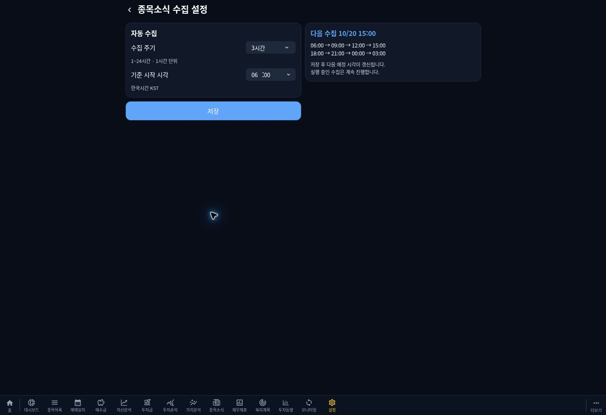

# 종목소식 수집 일정·후보 관리 및 대시보드 비중 개선

작업일: 2026-10-20 KST. 기획 버전 Figma v1.2. 일정·대시보드 배포 1.1.25, 운영 검증에서 확인한 리포트 코드 보완 1.1.26.
기준 main: 70b59c65f1671651c29a2fba5f14dfd8d3cf3534 (1.1.24).
별도 브랜치: feat/news-schedule-dashboard-20261020.

## 근거와 보존 범위

- [PR #279 조사 보고서](https://github.com/byungho-cho/roxstock/pull/279): run 12691의 후보 12건은 모두 실제 저장 12건이라는 뜻이 아니다. 당시 미저장 리포트 653074·653075·653078도 seen 처리되어 있었다.
- 새벽 실행 이후 발행 기사와 당시 누락 여부는 구분한다. 제목·수치·날짜의 Figma 예시는 운영 DB에 입력하지 않는다.
- Figma FXEeCL5ivBCuAtbVuPwvio의 5068:88·888(설정), 1308·1627(상태), 1736·1987(목록) 고해상도 컨텍스트와 스크린샷을 확인했다. C2100/T2100·C3200/T3200의 v1.2 기획 설명(5068:199·999·1986·2245)도 읽고 회차·예제 데이터·툴팁 조건을 대조했다.
- 34차 공통 성공 토스트, 보유 ≥1주 강조, 원문 링크, 목록 페이지·스냅샷·상세 순번 및 본문만 스크롤하는 확장 카드를 보존한다. 이후 main의 요약 최초 수집 1회 정책과 하단 메뉴·비중별 글자색도 유지한다.
- 운영 원문 전체·PDF·키·계좌 정보·DB 덤프를 저장소에 추가하지 않는다. 신규 AI·OCR·PDF 패키지·네이티브 변경은 없다.

## 일정과 설정

`stock_news_schedule` 한 행에 1~24 정수 시간(기본 3), HH:mm(기본 06:00), KST 기준점 UTC 시각, 설정 revision을 저장한다.
`anchorAt + n × intervalHours` 산술로 실행한다. 5시간도 자정에 리셋하지 않으며 24시간은 매일 지정 시각이다.
설정 GET/PUT은 외부 제공처를 호출하지 않는다. PUT 검증 후 기준점을 저장 당일의 선택 시각으로 재설정하고 revision을 올린다. 저장 이전 회차는 실행하지 않으며 다음 미래 회차부터 적용한다. 실행 중 작업은 시작 시 읽은 설정으로 끝낸다.

설정 권한은 기존 설치 단위 종목 관리·수집 설정 API와 동일한 경계다. 백업 전용 관리자 세션을 다른 운영 설정에 새로 요구하지 않는다. 계좌별 예약을 만들지 않는다.
설정 화면은 기존 FormSelect의 선택적 compact 모드(28px), 공통 토스트를 재사용한다. 오른쪽 컨트롤 영역 112px, 커버 세로/태블릿 두 열이다. 시작 시·분은 각각 선택 가능하며 두 행 오른쪽 끝이 일치한다. 실패한 입력은 남긴다.

`stock_news_slots.key`로 INITIAL/REGULAR/SUPPLEMENT 회차를 유일하게 관리한다. 동일 회차는 최대 3회, 제공처별 복구 가능한 실패만 15·30분 뒤 재시도한다. 정규 회차가 오면 오래된 재시도를 합친다. 지연·재시작 시 최신 회차 하나만 실행하고 지난 회차를 반복 실행하지 않는다.
모든 경로는 기존 stock-news DB 잠금, 소유권·유효기간 검사와 8분 상한을 공유한다. DART 공유 예산·최소 간격·재무 수집 잠금·수동 우선권은 변경하지 않는다.

## 후보·일일 선별 정책

- 실제 저장 중복: stock_news_items의 URL hash/fingerprint 및 provider+providerId로 판단한다. 종목 관계만 추가할 수 있고 기존 본문 메타데이터·저장 시각을 덮어쓰지 않는다.
- seen은 관측 이력이다. 실제 저장되지 않은 seen 키만으로 영구 중복 처리하지 않는다.
- stock_news_candidates에 공개 메타데이터, 관련 종목 ID, 우선순위, 게시 시각, 상태·사유·확인 시각을 저장한다. 본문·PDF·요약 원문은 후보 payload에 넣지 않는다.
- STORED / DEFERRED(SELECTION_RANK 또는 DAILY_LIMIT) / EXCLUDED를 구분한다. 순위·건수 제외는 게시 후 72시간 내 DB 상위 200건을 재평가한다. 현재 수집 대상과 교집합이 없는 후보는 게시하지 않는다.
- 전체 계좌가 공유하는 **KST 저장일 기준 하루 최대 10개 신규 소식**이다. 종목·계좌·제공처별 10개가 아니다. 기존 선별 목표 약 5개/회와 중요 우선 정렬을 유지하면서 그날 이미 저장된 개수를 차감한다. 기존 소식의 관계 추가는 새 게시 건수에 포함하지 않는다.
- 과거 seen은 매회 최대 200키를 실제 소식과 대조한다. 미저장·사유 불명은 RECHECK_AVAILABLE로 보존한다. 메타데이터가 없는 키를 임의 기사로 복원하지 않고 제공처 재발견 후에만 관련성·시각·중요도를 평가한다. 보고서 리포트 3건도 같은 경로로 처리한다.
- 후보 metadata는 30일 보존 후 최대 200건씩 정리한다. 완료 회차는 30일 이후 100건씩 정리하고, 실행별 상세 진단은 30일 이후 10개 실행씩 제거하되 합계·실행 이력은 유지한다. 실제 소식과 기존 seen 키는 지우지 않는다.

## 제공처 커서·상태·진단

- RSS는 channel pubDate를 빼고 유효한 item 날짜만 집계한다. 최초 배포일 전까지 요구하지 않는다. 경고가 있어도 유효 후보는 처리하며 후보 존재로 경고를 SUCCESS에 숨기지 않는다.
- 연속 확인 watermark와 마지막 조회 lastCheckedAt을 분리한다. 과거 구간 누락 시 watermark를 전진시키지 않는다. 누락 범위·피드·이유를 최대 24개 보존한다. RSS 후속 조회는 lastCheckedAt과 제한된 72시간 중첩을 사용하므로 미복구 과거 전체를 매번 다시 조회하지 않는다. 리포트와 DART는 정상 확인 watermark를 기준으로 중첩 조회하므로 기업 매핑·API 실패 구간을 조회 시각만으로 건너뛰지 않는다.
- RSS 보존 범위 부족은 자동 재조회로 복구 불가한 coverage 경고다. 무한 재시도하지 않고 미확인 이력으로 남긴다. 통신·파싱 오류, 쿼터, 수동 작업 양보 등 복구 가능한 상태는 제한 재시도한다.
- 제공처별 동일 회차의 성공·정상 제외 결과는 다른 제공처 재시도 때 재사용한다. 정규 회차에서는 새 자료를 다시 확인한다.
- DART 기업공시는 DB의 검증된 securityType ETF·ETN을 정상 제외한다. 이름으로 추정하지 않는다. 일반 기업 매핑 누락, API 실패, 쿼터/잠금 양보는 서로 다른 코드다.
- 대상 단위는 활성 계좌들의 보유·관심·거래 이력을 합친 고유 종목 수다. 제공처별 원천 파싱·기간 통과·종목 매칭, 저장 중복·이전 제외·이번 선별 제외·신규 저장·관계 추가 진단을 기록한다. 제공처 응답이 후보만 제공하는 테스트 경로에는 원천 수치를 추정하지 않는다.

## 시각과 UI

최근 시도(lastAttemptAt), 실행 종료(lastFinishedAt), 전체 정상 완료(lastFullSuccessAt), 최근 신규 저장(lastNewStoredAt), 다음 정규 실행, 예약된 다음 재시도를 구분한다. PARTIAL은 전체 정상 완료 시각을 갱신하지 않는다. 기존 다른 수집기의 성공 의미는 바꾸지 않는다.

목록은 저장된 수집 종료 시각을 `최근 확인 MM/DD HH:mm`으로 표시한다. PARTIAL/FAILED는 제목 옆 공통 클릭·키보드 툴팁으로 미확인 범위와 실제 예정 시각을 안내한다. 예약 없는 재시도 시각은 표시하지 않는다. 정상 0건은 오류가 아니다. 조회 실패 때 기존 목록은 보존한다.
상태 화면은 설정과 같은 DB 일정·공유 계산을 사용하며 최근 시각과 제공처 결과를 두 카드로 표시한다.

## 대시보드 7종목·기타

주식 평가액 기준 비중 내림차순(동률 ID 순), 7종목 이하는 실제 이름 전부, 8종목 이상은 상위 7개 + 나머지 합계 기타다. 기타는 무조건 마지막이며 예수금은 합치지 않는다. 이름 조회 실패는 종목명 미확인(ID)으로 남긴다.
도넛·범례·누적 막대·개별 목록 및 순위형/누적형은 동일 items와 8색 팔레트를 사용한다. 기타 행도 클릭 시 종목목록으로 이동한다. 기존 비중 합계·평가금액·비중 글자색은 유지한다. 범례 높이는 항목 수에 따라 늘어나며 고정 6슬롯을 제거한다.

## DB 변경·배포·롤백

추가 마이그레이션 `20261020030000_news_schedule_candidates`:
기존 state/provider/seen에 nullable 또는 기본값 열·인덱스를 추가하고 schedule/slots/candidates를 신설한다. 기존 뉴스·관계·거래·재무값은 변경하지 않는다. PARTIAL 기록에서 정상 완료 시각을 추정하지 않는다. 마지막 신규 저장은 실제 items 최대 collectedAt으로 초기화한다.

기존 운영 배포 전 백업·gzip/체크섬 확인 절차를 그대로 실행한다. 기존 이미지 70b59c6/각 운영 서비스 이전 SHA는 추가된 테이블·열과 호환된다. 롤백은 각 서비스 이전 이미지로 복귀하고 새 스키마·설정·소식·이력을 남긴다. 정상 롤백에 전체 DB 복원이나 열 삭제를 사용하지 않는다. 이전 수집기는 1일 1회 정책으로 돌아가므로 collector 롤백 시 새 반복 일정은 중지됨을 확인한다. 새 회차와 이전 collector를 동시에 실행하지 않는다.

배포 job은 backend·collector·frontend의 정확한 대상 이미지 확인 후 `news-supplement 2026-10-20`을 실행한다. SUPPLEMENT 날짜 키로 중복 실행을 막고, 잠금 경합만 제한 대기한다. 다른 KST 날짜면 임의로 날짜를 바꾸지 않고 미실행을 보고한다.
실제 신규·중복·선별 제외·관계·실패·미확인 범위·다음 일정과 제한 페이지의 계좌별 저장 목록 조회 결과는 배포 Actions의 `NEWS35_PRODUCTION_RESULT` 및 PR 최종 결과를 근거로 한다. 배포 시작만으로 운영 보완 완료를 주장하지 않는다.

## 실제 검증 결과

최종 기능 head `8ca481d943032e4cc8afcd655ceb09e4c02dba18`의 [PR Validation](https://github.com/byungho-cho/roxstock/actions/runs/39363647945)과 기존 회귀 workflow 31개가 성공했다. 경로 조건부 6개는 정상 생략됐고 실패는 0개다.

- 로컬 shared 96, collector 228, backend 142, 비중 정책 8개, 배포 자동화 JS 46/Python 7개 통과. 세 서비스 타입 검사·빌드 통과.
- 실제 MariaDB 검증 DB에서 KST 일일 저장 10건 상한, 선별 탈락 후보 5건 재선별, 미저장 legacy seen 재평가, 정상 제공처 재사용, 동일 회차 1회·놓친 회차 합치기·보완 1회, 설정 범위 검증·저장 시 수집 미실행·실행 중 설정 변경 보존을 확인했다.
- 후보가 있어도 RSS 범위 경고를 PARTIAL로 남기는 것, 연속 확인 커서를 전진시키지 않는 것, 복원 불가 범위를 무한 재시도하지 않는 것, 리포트·DART가 정상 확인 커서를 사용하는 것을 검증했다.
- 제어 가능한 시계로 1·3·5·24시간, 자정·월말·연말·미래 기준점·재시작 후 계산을 확인했다. 실제 몇 시간씩 기다리지 않았다.
- Chromium에서 커버 370×465·태블릿 725×396의 신규 UI 20개가 통과했다. 설정 28px·우측 정렬·토스트·실패 입력 보존, 설정/상태/목록 시각, 0·1·5·6·7·8·다수 종목, 기타 행·순서·색상·계좌/순위 변경·스크롤을 확인했다.
- 기존 외화 2개·32차 홈 8개·33차 소식 16개·34차 토스트/레이아웃 8개·하단 메뉴 15개 UI 회귀도 통과했다. 설정·상태·목록·대시보드의 [최종 화면 아티팩트](https://github.com/byungho-cho/roxstock/actions/runs/39363647945/artifacts/12238154818)를 열어 Figma v1.2와 시각 대조했다.
- 처음 발견한 실제 셀렉트 클릭 영역 23px 및 평가액 0 종목의 1px 로딩 프레임 차이는 실제 레이아웃을 교정한 뒤 최종 head에서 회귀 통과했다.

위 일일 10건·후보 5건은 검증 DB의 수치다. 운영 수치와 혼용하지 않는다.

## 운영 결과

[PR #280](https://github.com/byungho-cho/roxstock/pull/280)을 `eb48c7cdb5a75400e867b0058844806384a13d81`로 병합했다. [Production Deploy](https://github.com/byungho-cho/roxstock/actions/runs/39365038021)는 성공했다. 운영 DB 백업 검증 후 마이그레이션 적용, backend·collector·frontend의 해당 SHA 이미지와 정상 기동을 확인했다. 네이티브 변경이 없어 APK는 생략됐다.

2026-10-20 12:57~12:59 KST, SUPPLEMENT 실행 12981의 [운영 결과 아티팩트](https://github.com/byungho-cho/roxstock/actions/runs/39365038021/artifacts/12239882105):

| 항목 | 실제 결과 |
|---|---:|
| 신규 저장 | 5건(공시 1·리포트 3·기사 1) |
| 저장된 소식 기준 중복 | 고유 후보 5건(DART 4·리포트 1) |
| 후보 중복 관측 합계 | 10건(기저장 및 이번 조회 후보 간 중복 포함) |
| 유효 후보 선별 보류 | 1건 |
| 기존 소식 관계 추가 | 0건 |
| 완전 FAILED 제공처 | 0개 |
| PARTIAL 제공처 | 2개(RSS 보존 범위·DART 기업 매핑) |
| 전체 공유 저장 소식 | 10건(기존 5 + 신규 5) |
| 저장 목록 검증 | 활성 5계좌, 각 최초 페이지 최대 10개와 계좌 경계 확인 |

계좌별 조회 가능 전체 건수의 합은 16건이며 공유 소식이 여러 계좌에 포함되므로 고유 저장 16건이라는 뜻이 아니다. 실제 웹에서 확인한 한 계좌는 목록 4/4 → 8/8, 최근 확인 10/20 12:59였다. 계좌 식별자·잔고·거래 내용은 보고서에 게시하지 않는다.

| 제공처 | 결과 | 원천 파싱 | 기간 통과 | 종목 매칭 | 저장 중복 | 과거 관측/제외 후보 | 이번 선별 제외* | 신규 저장 |
|---|---|---:|---:|---:|---:|---:|---:|---:|
| DART | PARTIAL | 75 | 28 | 26 | 4 | 4 | 8 | 1 |
| 리포트 | SUCCESS | 91 | 91 | 6 | 1 | 4 | 1 | 3 |
| 한경 RSS | PARTIAL | 150 | 142 | 4 | 0 | 0 | 3 | 1 |

각 열은 서로 다른 처리 단계다. 원천/매칭은 제공처 관측 수, 저장 중복·과거 관측·저장은 정규화된 후보 수다. 과거 관측에는 사유 불명 legacy seen과 기존 저장 후보도 포함되어 이를 전부 과거 순위 탈락으로 단정하지 않는다. `*` 제공처 선별 제외는 중요도/관련성 단계의 제외와 유효 후보의 순위 보류를 포함하며 전역 선별 보류 1건과 다르다.

남은 상태: finance RSS 10/19 00:00~15:32, economy RSS 10/19 00:00~22:15 KST는 보존 범위 밖으로 확인 불가다. 확인 완료로 커서를 전진시키지 않았고 무한 재시도를 예약하지 않았다. DART는 DB 상품 유형이 ETF·ETN인 2종목을 정상 제외하고 기업 매핑 누락 1종목을 별도로 남겼다. 통신/API 실패나 쿼터 고갈로 기록한 FAILED 제공처는 없다. 전체 정상 완료 시각은 —로 유지했다. 새 소식이 없었다고 단정하지 않는다.

기본 설정은 3시간·06:00 KST, 다음 정규 실행 10/20 15:00, 예약된 다음 재시도는 없음이다. 운영 설정·상태·목록의 값이 일치하는지 실제 웹에서 확인했다. 설정 입력이나 저장 버튼을 운영 시험 목적으로 변경하지 않았다.

### 운영 검증 중 추가 발견한 리포트 오연결 보완(1.1.26)

운영 목록에서 `KT&G(033780)` 리포트에 `KT`가 함께 표시되는 기존 부분 이름 매칭을 확인했다. 명시된 종목코드가 있는 리포트는 정확한 코드로만 연결하고 코드 없는 자료의 기존 정책은 보존한다. KT만 대상인 계좌에 KT&G 리포트가 노출되는 회귀를 검증한다.

`news-report-reconcile`은 기존 stock-news 잠금·소유권 검증 아래 뉴스 100개·후보 200개·소식별 관계 100개로 제한해 DB만 확인한다. 공식 리포트 URL과 providerId가 일치하고 제목에 명확한 종목코드가 있는 경우에만 다른 코드의 관계를 정정한다. 소식·요약·게시/저장 시각과 올바른 관계는 보존한다. 후보 payload의 잘못된 관계도 함께 정정해 다음 재선별에서 재발하지 않도록 한다. 수정 전 관계와 후보 상태/ID는 DB의 별도 maintenance 실행 metadata에 보존하며 계좌 정보나 본문을 로그로 내보내지 않는다.

1.1.26의 backend·collector 운영 배포가 성공한 뒤 별도 `News Report Identity Verification` 작업으로 정정 및 조사 리포트 653074·653075·653078의 실제 저장/후보 상태를 확인한다. 외부 호출·요약 생성·오늘 SUPPLEMENT 수집을 반복하지 않는다. 스키마 추가 변경은 없다. 이번 정정은 API의 버전 응답으로 메뉴 버전을 갱신하므로 변경 없는 frontend 이미지와 APK를 다시 배포하지 않는다.

1.1.26 롤백은 해당 backend·collector의 이전 1.1.25 이미지(eb48c7c 계열)로 복귀하고 기존 DB·설정·정정 이력을 유지한다. 이전 수집기는 부분 이름 매칭을 다시 만들 수 있으므로 collector 롤백 시 이를 확인한다. 정정 자체를 되돌려야 하는 예외에서는 maintenance 실행 metadata의 정확한 관계 쌍과 후보 이전 상태를 검토해 복원하며 전체 DB 복원을 정상 롤백으로 사용하지 않는다.

후속 PR·검증 DB·정정 실행의 실제 결과는 확인 후 이 절에 갱신한다.

## 미검증·제한

물리 Fold의 실제 안전 영역·기기 회전은 직접 검증하지 않았다. 커버·태블릿 검사는 Chromium의 지정 뷰포트 기준이다. 제공처가 제공하지 않는 과거 RSS 구간의 복원은 보장하지 않으며 미확인 범위로 남긴다. 운영 제공처의 장애·쿼터 고갈을 인위적으로 만들지 않았고 관련 오류 처리는 통제된 응답과 검증 DB로 확인했다. 신규 AI·OCR·범용 PDF 처리 및 APK 배포는 이번 변경에 포함하지 않는다.
